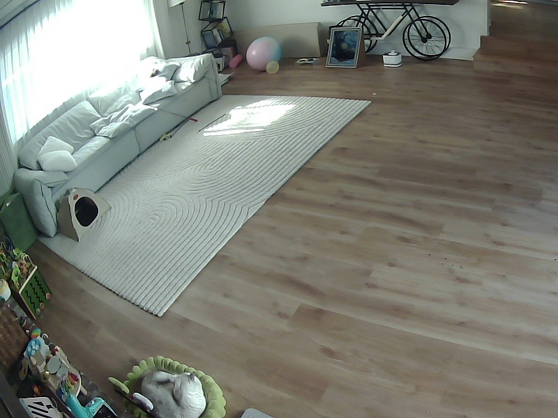

# Experiment: cat false-negative audit — run `20261031-191639-476397`

- Date (local): 2026-10-31 19:16:39 → 19:18:48
- Agent: `supervisor_agent` (`MCPAgent`), model `muse-spark-1.3` via Meta Model API Responses endpoint
- Camera: view 3 — Living Room Black Camera (Wide), `800x600`, sim/replay of `2026-10-27T18:00:00–18:06:21`
- Outcome: **false negative confirmed** — a sleeping cat is clearly visible in the green bed at the
  bottom of the frame, but the default loop reported `detections: []` and the `yolov8s` escalation
  found no cat either.
- Sources: `agent/output/agent_runs/20261031-191639-476397/run.json` (previews only),
  MySQL `agent_invoke` / `tool_invoke` (`AGENT_INVOKE_DUMP=true`, full text), live MCP schema capture,
  and the CLI transcript pasted with the request. `agent/output/` is gitignored, so the two evidence
  frames are archived at `documents/assets/20261031-191639-476397/`.

## 1. Run identity

| Field | Value |
|---|---|
| `run_dir` | `output/agent_runs/20261031-191639-476397` |
| DB `agent_invoke.invoke_id` | `6a2770cd-45b5-4bd4-a82d-fa57e59fc210` |
| `invoke_time` (local) | 2026-10-31 19:16:39.476378 |
| `model` / `tag` | `muse-spark-1.3` / none |
| `turns` / tool calls | 5 turns (tools on 1–4, answer on 5) / 11 calls, 0 errors |
| `stopped_reason` | `answered` |
| `previous_response_id` | none (fresh conversation, no chaining) |
| `last_response_id` | `resp_6ae6a17e4ea63d77f73b46a4` |
| `images_sent` / `high_res_used` | 2 / 0 |

## 2. Invocation and runtime config

One-shot chat query (no `--task`, no `--labels`, no tag), equivalent to
`python -m supervisor_agent "<query>"` from `agent/` with the repo `.env` loaded:

- Endpoint: `https://api.meta.ai/v1` (OpenAI-compatible Responses API), `api_key_env=MODEL_API_KEY`
- `max_steps=12`, `image_detail=auto`, `reasoning_effort=None`, image/high-res budgets unlimited
- `RunOptions`: all defaults — no instruction override, all tools exposed, no `text.format`
- MCP servers from `.env`: camera `http://127.0.0.1:8766/mcp`,
  images `http://10.0.0.165:10001/mcp`, tracking `http://52.53.150.209:10002/mcp`,
  plus in-process `local` (agent_data helpers) and `skill` (task skills) toolsets
- 34 tools exposed; each sent as a Responses `function` tool with `strict: false` and the
  description truncated to 1024 chars (`tool_adapter.to_function_tool`)
- Code version: git HEAD `22ee281` with a dirty tree at doc time (`README.md`,
  `agent/camera_sim/sim_config.yaml`, `agent/memory/README.md`, `agent/supervisor_agent/agent.py`,
  `agent/supervisor_agent/config.py`, `agent/supervisor_agent/tests/test_tasks.py`,
  `existing_work_before_hackathon/tracking_mcp/README.md` modified; doc renames untracked).
  Whether the tree was dirty at run time is not recorded.

## 3. Full system prompt

`MCPAgent` never sends the `instructions` parameter (gateway 400s on chained image outputs —
see `documents/model-api-chaining-probe.md`). Instead `prompts.build_instructions` output is
prepended to the turn-1 input (`agent._fold_instructions`: `f"{instructions}\n\n{query}"`).
The text below is `BASE_INSTRUCTIONS` verbatim from `agent/supervisor_agent/prompts.py`,
followed by the per-server notes appended by `build_instructions`
(`\n[{name} server notes]\n{info}`), captured live on 2026-11-01:

```
You are the supervisor agent for RCAT, a home cat-monitoring system. A Raspberry Pi
camera runs a small YOLO detector continuously; past frames are stored on an SSD.
You answer the user's question by calling tools, only as many as the question needs.

Tool groups (tool names are prefixed by server):
- camera__*  : the live camera. get_status for the current state and last detections;
               capture_frame / capture_roi to look; detect to re-check with a bigger model;
               get_track_history / get_track_frame to inspect tracks; set_schedule /
               reset_schedule to change frame rate, crop region or model temporarily.
- images__*  : stored history images. Names are capture timestamps
               YYYY-MM-DD-HH-MM-SS-ffffff.jpg. list_images to discover names for a
               day / hour / minute, image_exists / images_exist to check cheaply, then
               get_image only for the images you need to look at.
- tracking__* : the tracker's corrected results. get_live_status / get_last_seen /
               get_current_periods read the websocket server's memory (what is happening
               now, not saved yet); get_periods / get_raw_detections read the database;
               get_period_detail, get_arrival_path and get_last_movement merge both.
               list_views maps cat names to cat ids.
- local__*   : in-process helpers over agent_data/: get_cat_profiles (written descriptions of
               each cat), find_references / get_reference_image (owner photos and confirmed
               camera crops), make_contact_sheet (several crops as one image),
               analyze_trajectory (physics check of a visit, no images), get_label_set,
               zones_for_box. Prefer these over fetching many images.

Guidelines:
- Prefer cheap calls first (status, existence checks) and fetch images only when
  you need to see them. Use max_side to keep images small unless detail matters.
- capture_frame / capture_roi are limited to get_status.capture_size (the always-on
  stream). When the user asks for the highest resolution or fine detail, use
  capture_high_res (pass box to zoom on one area). It pauses detection for a few
  seconds, so don't call it repeatedly. Report full_size from its reply.
- Boxes are [x1, y1, x2, y2] in the camera's display pixels.
- When you look at an image, say what you actually see; do not invent detections.
- Tracking data: say whether a value is final. A period with status ongoing or
  ended_pending, or a frame with final=false, can still change. A period's cat_id is the
  cat identity to trust; a single frame's cat_id / detector_cat_id are only labels.
- Every tracking frame has an image_name; to show it, pass it to images__get_image
  (box=crop_box to zoom on the cat).
- For "where did the cat come from / how did it get there", call
  tracking__get_arrival_path, fetch its key frames with images__get_image in one turn,
  and check them before answering. If a frame shows a different cat or no cat, say so.
- Only call set_schedule if the user asks to change camera behaviour; always give a
  ttl_s and explain what you changed.
- If a tool returns an error or a server is unavailable, say so and continue with
  what you have.
- End with a direct answer. When useful, mention which tools you used and the
  server-side elapsed_ms they reported.

[camera server notes]
Controls the RCAT cat camera on a Raspberry Pi. The camera always runs a default
detection loop and streams results over WebSocket; these tools let you inspect
frames, run bigger models on hard frames, zoom into regions, and temporarily
change the loop's frame rate / crop / model.

Resolution: capture_frame reads the always-on stream (get_status.capture_size, often
well below the sensor); it is instant and can look back with `at`. For more detail
(e.g. zooming into a small box) use capture_high_res; get_camera_modes lists what the camera supports.
Images are always returned as JPEG.

Coordinates: every box (input and output) is [x1, y1, x2, y2] in display pixels,
the same space as the WebSocket detections (see get_status.display_size).
Times: ISO 8601, or the WebSocket create_time string.
Schedule changes always expire (duration_seconds); the camera returns to defaults on its own.

[tracking server notes]
Cat tracking results for the home cameras, used to check detections and find reference frames.

Terms:
- detection: one box the detector model found on one frame, with conf (0-1) and the cat it
  thinks it is (detector_cat_id).
- track: the tracker links detections frame to frame into one moving box per cat. Short gaps
  are filled in; those boxes have interpolated=true and no detection behind them.
- period: one continuous visit of one cat on screen, from when it appears until it leaves.
  Its cat_id is decided from all detections in the visit, so it is more reliable than the
  label on any single frame. evidence_by_cat shows, per cat, how many detections named it,
  their average conf, and a score; the cat with the highest score is chosen.
- period status: ongoing (cat still on screen), ended_pending (visit ended, cat_id may still
  change), final (saved, will not change).
- final=false on a frame: the box is from the last ~15 s and can still be corrected.

Boxes are [x1, y1, x2, y2] in the camera view's pixels (640x480 unless list_views says
otherwise). Every frame has image_name: pass it to images__get_image (box=crop_box to zoom on
the cat). edge is the image border nearest the box (left, right, top, bottom or none).
Call list_views first to map cat names to cat_id.

[local server notes]
Cat profiles, reference images, trajectory checks, contact sheets, label set and zones (agent_data/).

[skill server notes]
Task skills (skills/): invoking one loads its full instructions.
```

Caveat: the `[images server notes]` block (and any `Unavailable servers right now: ...` line)
depend on whether the images MCP server was reachable at run time. On 2026-11-01 it was
unreachable (`could not connect`); its state during this run is not recorded, and no
`images__*` tool was called either way.

## 4. User input (verbatim, including typo)

> fetch the latest camera view and identify any potential cat in the view. compare to the detection and report any inaccurect detection.

## 5. Tools available and tools used

34 tools were exposed (names captured live 2026-11-01; assumed identical at run time):

- camera: `capture_frame`, `capture_high_res`, `detect`, `get_camera_modes`, `get_status`,
  `get_track_frame`, `get_track_history`, `list_buffered_frames`, `list_models`,
  `reset_schedule`, `set_schedule`
- tracking: `get_arrival_path`, `get_current_periods`, `get_last_movement`, `get_last_seen`,
  `get_live_status`, `get_period_detail`, `get_periods`, `get_raw_detections`, `list_views`
- local: `add_label`, `analyze_trajectory`, `find_references`, `get_cat_profiles`,
  `get_label_set`, `get_reference_image`, `get_zones`, `make_contact_sheet`, `save_zone`,
  `zones_for_box`
- skill: `assign-activity-label`, `check-trajectory`, `manage-labels`, `validate-cat-identity`
- (images server tools absent from this capture because that server was down; see caveat above)

The 9 tools used, with their descriptions and input schemas:

- `camera__get_status` — "Current mode (default/override), effective settings and time left on
  any override, loop and camera FPS, last detection message, available models, cat names, frame
  buffer span, and WebSocket state." Schema: `{}` (no properties).
- `tracking__list_views` — "List the camera views: view_id, name, frame size and the cats in
  each view (cat_id -> name). live_views are the views this server is receiving frames for now.
  Call this first to turn a cat's name into its cat_id." Schema: `{}`.
- `tracking__get_live_status` — "What the camera sees right now. Per view: the last frame
  received (time, seconds_ago, image_name) and every detection on it, including ones below
  min_confidence that the tracker ignores. Per cat: name, on_screen, current_period_id (the
  ongoing visit, null if not on screen), last_period_id, and latest_detection (newest frame
  where the detector found it; final=false). view_id limits the reply to one view."
  Schema: `{"view_id": int|null}`.
- `local__get_cat_profiles` — "Written profiles of the household cats: name, tracker ids per
  view, summary, low-res and camera cues, how to tell them apart. detail='full' adds the long
  description and high-res cues (eyes, nose). cat_ids may be profile ids or tracker ids
  (e.g. 25/26 on view 3)."
  Schema: `{"cat_ids": [int], "view_id": int, "detail": "low_res"|"full" (default low_res)}`.
- `camera__capture_frame` — "Grab the newest frame of the always-on stream (or the buffered
  frame nearest `at`). box crops it (display coords, padded by `padding` x box size); for a
  sharper zoom use capture_high_res with the same box. The image is shrunk so its longest side
  is <= max_side (null = no resize). Instant; does not interrupt the detection loop."
  Schema: `{"box": [int,int,int,int]|null, "padding": number (0.15), "max_side": int|null (1280),
  "at": string|null}`.
- `tracking__get_current_periods` — "Visits happening now or that just ended, before they are
  saved. Use it for "what is on camera now / in the last few minutes"; use get_periods for
  anything older. not_final: visits with status ongoing or ended_pending, each with start, end,
  duration_s, the cat_id it would get if decided now (can still change), evidence_by_cat, frame
  count and first / last frame. recently_final: the newest visits (up to final_limit) that
  became final since this server started."
  Schema: `{"view_id": int|null, "final_limit": int (10)}`.
- `camera__detect` — "Escalate: run one detection pass with `model` (one of: default, yolov8s;
  list_models describes them) on the newest frame or the buffered frame nearest `at`,
  optionally only inside `roi` (full-res crop) and at input size `imgsz` [w, h]. Does not touch
  the tracker. Delays the default loop by one inference."
  Schema: `{"model": string ("default"), "at": string|null, "roi": [int…]|null,
  "imgsz": [int…]|null, "conf": number|null}`.
- `camera__get_camera_modes` — "Resolutions capture_high_res supports (sizes, largest first;
  max_size = largest) and the current always-on capture_size." Schema: `{}`.
- `camera__get_track_history` — "Tracks seen by the default loop: first/last seen time and box,
  hits, max confidence, and cat_id counts. identity_consistent=false means the track changed
  cat_id at least once (a likely ID switch worth validating). Track IDs restart (new epoch)
  whenever the loop's model/roi/imgsz changes. `at` returns only tracks seen within
  window_seconds of that time (from every epoch). Short-term only: kept in the camera's memory
  (last 500 tracks, lost on restart). …"
  Schema: `{"limit": int (50), "all_epochs": bool, "at": string|null, "window_seconds": number (2.0)}`.

## 6. Turn-by-turn process

Calls within a turn run concurrently (`asyncio.gather`); the turn's tool cost is the slowest
call, not the sum. CLI transcript (`→` model calls, `←` results):

```
→ camera__get_status({})
→ tracking__list_views({})
→ tracking__get_live_status({})
← camera__get_status: ok (round trip 0.009 s)
← tracking__list_views: ok (round trip 0.05 s, server 0.006 s)
← tracking__get_live_status: ok (round trip 0.051 s, server 0.009 s)
→ camera__capture_frame({"max_side":1280})
→ local__get_cat_profiles({"detail":"low_res","view_id":3})
→ tracking__get_current_periods({"view_id":3})
← local__get_cat_profiles: ok (round trip 0.006 s)
← camera__capture_frame: ok (round trip 0.017 s, 1 image(s) saved)
← tracking__get_current_periods: ok (round trip 0.052 s, server 0.006 s)
→ camera__detect({"model":"default"})
→ camera__get_track_history({"limit":20})
→ camera__get_camera_modes({})
← camera__get_track_history: ok (round trip 0.009 s)
← camera__get_camera_modes: ok (round trip 0.009 s)
← camera__detect: ok (round trip 0.12 s)
→ camera__capture_frame({"box":[140,480,330,600],"max_side":1280,"padding":0.3})
→ camera__detect({"model":"yolov8s"})
← camera__capture_frame: ok (round trip 0.005 s, 1 image(s) saved)
← camera__detect: ok (round trip 0.48 s)
```

What each turn established (see §11 for the full JSON of every call):

- Turn 1 (batch 19:16:41.666): status + views + live status. Camera is view 3, `sim:true`,
  replaying `2026-10-27T18:00:00–18:06:21`, last loop message `2026-10-27-18-01-22-768257` with
  `detections: []`; websocket `connected:false, queue:227, sent:0`. Views 1/2/3 known; live
  views `[3]`. Live status (server clock `2026-11-01T02:16:41`, i.e. a different day than the
  replay) shows a below-threshold `cat 26` box top-centre and an ongoing period 103039.
- Turn 2 (batch 19:17:25.270): full `800x600` frame at replay time `18:02:05.041` (1 image to
  the model, saved as `step05_capture_frame_1.jpg`); low-res cat profiles for view 3
  (Qb short white vs Qbo long cream); current periods (ongoing 103039 + 10 recently-final).
- Turn 3 (batch 19:17:55.858): `detect/default` on frame `18:02:34.868` → `detections: []`;
  track history: track 1 (212 hits, `26:207/25:5`, max conf 0.6698, last seen `18:01:18.740`,
  `identity_consistent:false`) and track 2 (3 hits, last seen `18:00:43.381`); camera modes:
  replay source, `capture_size [800,600]`, no higher sizes — no `capture_high_res` gain.
- Turn 4 (batch 19:18:20.061): zoomed crop of box `[140,480,330,600]` (returned
  `roi_display [83,444,387,600]`, `304x156`, saved as `step10_capture_frame_1.jpg`) plus
  `detect/yolov8s` on frame `18:02:58.441` → bicycle, 2 sports balls, bed; no cat.
- Turn 5: no tool calls; final answer below.

## 7. Final answer (verbatim)

> Latest view is `view 3 - Living Room Black Camera (Wide)` `800x600`.
>
> What I did:
> * `camera__get_status` - last loop message `2026-10-27-18-01-22-768257` had `detections: []`
> * `camera__capture_frame` at `2026-10-27T18:02:05.041` - full view
> * `camera__capture_frame` zoom on `[140,480,330,600]` at `2026-10-27T18:02:58.441`
> * `camera__detect` with `default` at `2026-10-27T18:02:34.868` -> `[]`
> * `camera__detect` with `yolov8s` at `2026-10-27T18:02:58.441` -> no cat
> * `camera__get_track_history`, `tracking__get_live_status`, `tracking__get_current_periods`, `local__get_cat_profiles` for context
> * `camera__get_camera_modes` - replay source, resolution fixed by files, `capture_size [800,600]`, no higher sizes - so no `capture_high_res` detail to gain.
>
> What I actually see:
>
> Full `800x600` frame: living room with light sofa left, white rug centre, wood floor, bicycle / picture frames / pink + yellow balls at back wall, steps right.
> At bottom edge, in a small green ruffled bed, one light white-grey cat curled sleeping. No other cat-like animal on sofa, rug, floor or back wall.
>
> Zoomed crop `[83,444,387,600]` display: same animal - curled white / light grey fur, head tucked, no fluffy halo, no dark brown paws / plume tail visible. Low-res cues match `Qb / Qb-2 (cat_id 25 view-3: Short-haired white, cool white to light silver, smooth sharp outline)` better than `Qbo / Qbo-2 (cat_id 26 view-3: long-haired cream/beige, fuzzy halo, big bushy plume tail, darker brown legs)` but sleeping curled view alone is not certain for identity.
>
> Comparison to detection - inaccurate / missed:
>
> 1. Default loop: `detections: []` - FALSE NEGATIVE. Cat clearly visible at bottom, approx box `[183,506,289,595]` display coords from track history.
> Re-run `default` model on nearest buffered frame also `detections: []`.
>
> 2. `yolov8s` escalate:
> ```
> bicycle [465,3,648,86] conf 0.8175
> sports ball [352,51,404,102] conf 0.7603
> bed [19,74,328,341] conf 0.6308 // the sofa
> sports ball [381,86,402,105] conf 0.3556
> ```
> No `cat` - also FALSE NEGATIVE for the sleeping cat.
>
> 3. Track history shows why:
> ```
> track 1 [191,507,299,597] -> [183,506,289,595] hits 212 cat_counts {26:207,25:5} max_conf 0.6698 last_seen 18:01:18.740 identity_consistent=false
> track 2 [192,504,300,598] hits 3 max_conf 0.416 last_seen 18:00:43.381
> ```
> i.e. the cat in the green bed WAS tracked as `Qbo-2 (26)` with 5 flips to `Qb-2 (25)`, then lost after `18:01:18` although still visible at `18:02:05` / `18:02:34` / `18:02:58`. Low max conf + identity flip means that `26` identity is uncertain.
>
> Note on `tracking__get_live_status`: it reports `2026-11-01T02:16:41` `view 3` detection `cat 26 [345,45,408,106] conf 0.421` below `min_confidence 0.5`, `current_period 103039 ongoing`. Camera is in `sim:true replay` of `2026-10-27T18:00:00-18:06:21` and `websocket connected:false queue:227 sent:0`. That live/tracking time does not match the replay frames I inspected, and top-centre `[345,45,408,106]` in the Oct-27 frame is balls / wall area with no cat. Do not trust it for this frame.

## 8. Time, token and cost accounting

From `run.json` / `agent_invoke` (identical values):

| Metric | Value |
|---|---|
| Wall total | 128828.2 ms (128.828 s; end ≈ 19:18:48.3) |
| LLM (`llm_ms`, all 5 turns) | 128116.5 ms (99.4% of wall) |
| Tools (`tools_ms`, 4 batches) | 711.0 ms ≈ max-per-turn 50.52+51.77+119.99+479.73 = 702.01 ms + overhead |
| `input_tokens` / `output_tokens` / `total` | 61906 / 6677 / 68583 |
| `cached_tokens` (subset of input) | 33875 |

Per-turn tool-batch start times (local, from `tool_invoke`): T1 19:16:41.666, T2 19:17:25.270,
T3 19:17:55.858, T4 19:18:20.061. Per-turn LLM slices are not recorded (only the cumulative
`llm_ms`), and per-call LLM token splits are not recorded either.

Cost (`models.json` pricing for `muse-spark-1.3`, Standard tier, retrieved 2026-10-26:
input $1.25 / cached $0.15 / output $4.25 per 1M tokens):

> uncached = 61906 − 33875 = 28031 → 28031 × 1.25 = 35038.75
> cached = 33875 × 0.15 = 5081.25 · output = 6677 × 4.25 = 28377.25
> total = 68497.25 / 1e6 = **$0.068497 → $0.0685** (matches the CLI footer and DB `est_cost_usd`)

CLI footer for reference:
`[muse-spark-1.3 | turns 5 | tool calls 11 | LLM 128.117 s | tools 0.711 s | total 128.828 s | tokens in 61906 / out 6677 / total 68583 | est. cost $0.0685]`

## 9. Evidence images

Archived copies (originals under gitignored `agent/output/agent_runs/20261031-191639-476397/`):



*`step05_capture_frame_1.jpg` — 800x600, full view, `captured_at 2026-10-27T18:02:05.041`.*

![zoomed 304x156 crop, roi_display [83,444,387,600] — same curled cat, head tucked, no plume tail visible](assets/20261031-191639-476397/step10_capture_frame_1.jpg)

*`step10_capture_frame_1.jpg` — 304x156 crop of box `[140,480,330,600]` + 0.3 padding,
`captured_at 2026-10-27T18:02:58.441`. Both frames were also sent to the model as
`input_image` items (`detail: auto`).*

## 10. Findings

1. Default detector loop: false negative — `detections: []` while the cat is plainly visible
   (~`[183,506,289,595]`); a fresh `default` pass on the `18:02:34` frame agrees (`[]`).
2. `yolov8s` escalation: false negative for the cat — finds bicycle / balls / sofa-as-bed only.
3. The tracker previously held this cat (track 1, 212 hits, mostly id 26 with 5 flips to 25,
   max conf 0.67) but dropped it after `18:01:18` despite no visible change; the 26 identity
   is therefore uncertain, and the agent's visual read leans 25 (Qb) without certainty.
4. Tracking-backend state (`get_live_status` / `get_current_periods`) is on a different clock
   (Nov-01) than the camera replay (Oct-27) with the websocket disconnected, so its "ongoing
   period 103039 / cat 26 top-centre" must not be read as evidence about these frames — the
   agent correctly discounted it.

## 11. Full tool inputs and outputs

Source: MySQL `tool_invoke` rows for this run (the invoke log stores the exact
`function_call_output` items, with base64 pixels replaced by `<N base64 chars>` placeholders).
`run.json` keeps only the first 300 chars of each text result, so this section is the complete
record. Steps are ordered by execution; the call order printed by the CLI within a turn may
differ because the batch runs concurrently.

### Step 1 — turn 1 — `camera__get_status`

- call_id: `call_7344498b-3a2e-425d-9871-c3b44bfbd3f2` · batch started: 2026-10-31 19:16:41.666171 (local) · round_trip_ms: 9.4 · images_returned: 0 · is_error: false

Input (`tool_input`, exactly as the model sent it):

```json
{}
```

Output (`tool_output` = the `function_call_output` items fed back to the model; base64 pixels replaced by the invoke-log placeholder):

```json
[
  {
    "tool": "camera__get_status",
    "round_trip_ms": 9.4
  },
  {
    "device_id": "c2d5f3ce14067817",
    "view_id": 3,
    "display_size": [
      800,
      600
    ],
    "capture_size": [
      800,
      600
    ],
    "camera_max_size": null,
    "camera_read_fps": 2.58,
    "control": {
      "mode": "default",
      "settings": {
        "fps": null,
        "roi": null,
        "imgsz": null,
        "model": "default"
      },
      "defaults": {
        "fps": null,
        "roi": null,
        "imgsz": null,
        "model": "default"
      },
      "override_expires_in_s": null,
      "override_reason": null,
      "pending_jobs": 0
    },
    "loop": {
      "frames_processed": 227,
      "loop_fps": 2.659,
      "last_message": {
        "detections": [],
        "is_grey": 0,
        "create_time": "2026-10-27-18-01-22-768257",
        "model_id": 70,
        "view_id": 3,
        "device_id": "c2d5f3ce14067817",
        "source": "default",
        "settings": null
      }
    },
    "models": [
      "default",
      "yolov8s"
    ],
    "cat_names": {
      "25": "Qb-2",
      "26": "Qbo-2"
    },
    "frame_buffer": {
      "count": 120,
      "oldest": "2026-10-27T18:00:39.293",
      "newest": "2026-10-27T18:01:22.768",
      "bytes": 9749845
    },
    "track_epoch": 0,
    "websocket": {
      "enabled": true,
      "url": "ws://127.0.0.1:8000",
      "connected": false,
      "queue": 227,
      "sent": 0
    },
    "image_upload_queue": 0,
    "sim": true,
    "replay": {
      "frames_total": 1049,
      "frames_served": 227,
      "seq": 227,
      "finished": false,
      "loop": true,
      "first": "2026-10-27T18:00:00.327",
      "last": "2026-10-27T18:06:21.272"
    }
  }
]
```

### Step 2 — turn 1 — `tracking__list_views`

- call_id: `call_9dddc37e-6654-4c9a-815d-0b05378f81d0` · batch started: 2026-10-31 19:16:41.666171 (local) · round_trip_ms: 49.7 · server_elapsed_ms: 5.671 · server_steps_ms: {"db": 5.661} · images_returned: 0 · is_error: false

Input (`tool_input`, exactly as the model sent it):

```json
{}
```

Output (`tool_output` = the `function_call_output` items fed back to the model; base64 pixels replaced by the invoke-log placeholder):

```json
[
  {
    "tool": "tracking__list_views",
    "round_trip_ms": 49.7
  },
  {
    "views": [
      {
        "view_id": 1,
        "view_name": "6253 Living Room",
        "cat_ids": [
          0,
          1,
          2
        ],
        "width": 800,
        "height": 600,
        "device_id": "b9967195f5076dc0",
        "cats": {
          "0": "Qb",
          "1": "Qbo",
          "2": "Yuki"
        }
      },
      {
        "view_id": 2,
        "view_name": "Living Room Black Camera",
        "cat_ids": [
          25,
          26
        ],
        "width": 640,
        "height": 640,
        "device_id": "c2d5f3ce14067817",
        "cats": {
          "25": "Qb-2",
          "26": "Qbo-2"
        }
      },
      {
        "view_id": 3,
        "view_name": "Living Room Black Camera (Wide)",
        "cat_ids": [
          25,
          26
        ],
        "width": 800,
        "height": 600,
        "device_id": "c2d5f3ce14067817",
        "cats": {
          "25": "Qb-2",
          "26": "Qbo-2"
        }
      }
    ],
    "live_views": [
      3
    ],
    "timing": {
      "elapsed_ms": 5.671,
      "steps_ms": {
        "db": 5.661
      }
    }
  }
]
```

### Step 3 — turn 1 — `tracking__get_live_status`

- call_id: `call_bf908c67-b55a-4408-ba4d-4405ea30bab9` · batch started: 2026-10-31 19:16:41.666171 (local) · round_trip_ms: 50.52 · server_elapsed_ms: 8.738 · server_steps_ms: {"memory": 1.614} · images_returned: 0 · is_error: false

Input (`tool_input`, exactly as the model sent it):

```json
{}
```

Output (`tool_output` = the `function_call_output` items fed back to the model; base64 pixels replaced by the invoke-log placeholder):

```json
[
  {
    "tool": "tracking__get_live_status",
    "round_trip_ms": 50.52
  },
  {
    "now": "2026-11-01T02:16:41.768308",
    "views": [
      {
        "view_id": 3,
        "last_frame": {
          "time": "2026-11-01T02:16:41.141199",
          "image_name": "2026-11-01-02-16-41-141199.jpg",
          "seconds_ago": 0.627,
          "detections": [
            {
              "cat_id": 26,
              "box": [
                345,
                45,
                408,
                106
              ],
              "conf": 0.421
            }
          ],
          "min_confidence": 0.5
        },
        "cats": [
          {
            "cat_id": 25,
            "on_screen": false,
            "current_period_id": null,
            "last_period_id": null,
            "latest_detection": null,
            "name": "Qb-2"
          },
          {
            "cat_id": 26,
            "on_screen": true,
            "current_period_id": 103039,
            "last_period_id": 103039,
            "latest_detection": {
              "time": "2026-11-01T02:16:40.781928",
              "image_name": "2026-11-01-02-16-40-781928.jpg",
              "box": [
                346.0,
                45.0,
                408.0,
                106.0
              ],
              "conf": 0.5762,
              "detector_cat_id": 26,
              "cat_id": 26,
              "interpolated": false,
              "final": false
            },
            "name": "Qbo-2"
          }
        ]
      }
    ],
    "server_started_at": "2026-10-28T07:42:56.343334",
    "timing": {
      "elapsed_ms": 8.738,
      "steps_ms": {
        "memory": 1.614
      }
    }
  }
]
```

### Step 4 — turn 2 — `local__get_cat_profiles`

- call_id: `call_596634c8-a37e-4c6d-a6fb-e2b28d3d74f5` · batch started: 2026-10-31 19:17:25.269872 (local) · round_trip_ms: 6.25 · images_returned: 0 · is_error: false

Input (`tool_input`, exactly as the model sent it):

```json
{
  "detail": "low_res",
  "view_id": 3
}
```

Output (`tool_output` = the `function_call_output` items fed back to the model; base64 pixels replaced by the invoke-log placeholder):

```json
[
  {
    "tool": "local__get_cat_profiles",
    "round_trip_ms": 6.25
  },
  {
    "cats": [
      {
        "cat_id": 0,
        "name": "Qb",
        "tracking_ids": {
          "view_1_old_living_room": 0,
          "view_3_black_living_room": 25
        },
        "summary": "Short-haired white cat with faint silver shading, round face and blue-green eyes.",
        "low_res_cues": [
          "Cool white to light silver colour, no warm cream or brown tones",
          "Smooth, sharp body outline (short fur, no fluffy halo)",
          "Thin tail with grey rings or a grey tip, often carried upright when walking",
          "Round head that looks large relative to a compact body",
          "Legs and paws white, same colour as the body"
        ],
        "camera_cues": [
          "From above, a compact bright-white oval with a smooth edge",
          "At night (purple low light or grey IR) still the brightest, most uniform blob",
          "No dark tail tip visible from above"
        ],
        "confused_with": [
          {
            "cat_id": 2,
            "how_to_tell": "Qbo is long-haired, warmer cream/beige, with darker brown paws and a big plume tail."
          },
          {
            "decoy": "white fluffy blankets, towels or bags (pure white, no head or tail shape)"
          }
        ]
      },
      {
        "cat_id": 2,
        "name": "Qbo",
        "tracking_ids": {
          "view_1_old_living_room": 1,
          "view_3_black_living_room": 26
        },
        "summary": "Long-haired cream and golden-beige cat with darker brown paws, face and plume tail.",
        "low_res_cues": [
          "Warm cream / beige colour, clearly warmer than Qb",
          "Fuzzy, soft body outline with a fluffy halo",
          "Big bushy plume tail, wider than the leg, grey-brown",
          "Darker brown lower legs and paws against a pale body",
          "Darker golden-brown patch in the centre of the face"
        ],
        "camera_cues": [
          "Dark brown plume tail tip clearly visible from above, even in low light (strongest cue)",
          "Fluffy, larger-looking body with a soft halo edge",
          "In daylight, warm cream body with darker hind legs"
        ],
        "confused_with": [
          {
            "cat_id": 0,
            "how_to_tell": "Qb is short-haired, cool white/silver, with a thin ringed tail and white paws."
          },
          {
            "decoy": "cream or beige plush toys, fluffy rugs and blankets"
          }
        ]
      }
    ]
  }
]
```

### Step 5 — turn 2 — `camera__capture_frame`

- call_id: `call_387ec331-6235-43ca-8445-199034b2113d` · batch started: 2026-10-31 19:17:25.269872 (local) · round_trip_ms: 16.94 · images_returned: 1 · is_error: false

Input (`tool_input`, exactly as the model sent it):

```json
{
  "max_side": 1280
}
```

Output (`tool_output` = the `function_call_output` items fed back to the model; base64 pixels replaced by the invoke-log placeholder):

```json
[
  {
    "tool": "camera__capture_frame",
    "round_trip_ms": 16.94
  },
  {
    "captured_at": "2026-10-27T18:02:05.041",
    "source_size": [
      800,
      600
    ],
    "returned_size": [
      800,
      600
    ]
  },
  {
    "type": "input_image",
    "image_url": "data:image/jpeg;base64,<21 base64 chars>",
    "detail": "auto"
  }
]
```

### Step 6 — turn 2 — `tracking__get_current_periods`

- call_id: `call_93b6d41c-7fbf-4db4-8ae2-8f6cd580980c` · batch started: 2026-10-31 19:17:25.269872 (local) · round_trip_ms: 51.77 · server_elapsed_ms: 6.135 · server_steps_ms: {"memory": 6.127} · images_returned: 0 · is_error: false

Input (`tool_input`, exactly as the model sent it):

```json
{
  "view_id": 3
}
```

Output (`tool_output` = the `function_call_output` items fed back to the model; base64 pixels replaced by the invoke-log placeholder):

```json
[
  {
    "tool": "tracking__get_current_periods",
    "round_trip_ms": 51.77
  },
  {
    "now": "2026-11-01T02:17:25.381409",
    "views": [
      {
        "view_id": 3,
        "not_final": [
          {
            "period_id": 103039,
            "view_id": 3,
            "status": "ongoing",
            "start": "2026-11-01T02:10:01.555334",
            "end": "2026-11-01T02:17:09.586722",
            "duration_s": 428.031,
            "cat_id": 26,
            "evidence_by_cat": {
              "25": {
                "detections": 0,
                "avg_conf": 0.0,
                "score": 0.0
              },
              "26": {
                "detections": 344,
                "avg_conf": 0.5652,
                "score": 11.2
              }
            },
            "frames": 1209,
            "first_frame": {
              "time": "2026-11-01T02:10:01.555334",
              "image_name": "2026-11-01-02-10-01-555334.jpg",
              "box": [
                346.0,
                45.0,
                409.0,
                107.0
              ],
              "conf": 0.6098,
              "detector_cat_id": 26,
              "cat_id": 26,
              "interpolated": false,
              "period_id": 103039,
              "final": true
            },
            "last_frame": {
              "time": "2026-11-01T02:17:09.586722",
              "image_name": "2026-11-01-02-17-09-586722.jpg",
              "box": [
                347.0,
                45.0,
                409.0,
                106.0
              ],
              "conf": 0.6149,
              "detector_cat_id": 26,
              "cat_id": 26,
              "interpolated": false,
              "period_id": 103039,
              "final": true
            }
          }
        ],
        "recently_final": [
          {
            "period_id": 103038,
            "view_id": 3,
            "status": "final",
            "start": "2026-10-29T19:44:23.548925",
            "end": "2026-10-29T19:44:28.901264",
            "duration_s": 5.352,
            "cat_id": 26,
            "evidence_by_cat": {
              "25": {
                "detections": 0,
                "avg_conf": 0.0,
                "score": 0.0
              },
              "26": {
                "detections": 4,
                "avg_conf": 0.5983,
                "score": 2.04
              }
            },
            "finalized_at": "2026-10-29T19:45:29.993265"
          },
          {
            "period_id": 103037,
            "view_id": 3,
            "status": "final",
            "start": "2026-10-29T19:37:52.084572",
            "end": "2026-10-29T19:39:40.986051",
            "duration_s": 108.901,
            "cat_id": 25,
            "evidence_by_cat": {
              "25": {
                "detections": 148,
                "avg_conf": 0.6566,
                "score": 12.2
              },
              "26": {
                "detections": 0,
                "avg_conf": 0.0,
                "score": 0.0
              }
            },
            "finalized_at": "2026-10-29T19:40:42.152977"
          },
          {
            "period_id": 103036,
            "view_id": 3,
            "status": "final",
            "start": "2026-10-29T19:24:49.208592",
            "end": "2026-10-29T19:38:26.598325",
            "duration_s": 817.39,
            "cat_id": 26,
            "evidence_by_cat": {
              "25": {
                "detections": 521,
                "avg_conf": 0.6656,
                "score": 5.0
              },
              "26": {
                "detections": 1428,
                "avg_conf": 0.6108,
                "score": 10.2
              }
            },
            "finalized_at": "2026-10-29T19:40:42.144466"
          },
          {
            "period_id": 103035,
            "view_id": 3,
            "status": "final",
            "start": "2026-10-29T19:23:36.988840",
            "end": "2026-10-29T19:23:55.748924",
            "duration_s": 18.76,
            "cat_id": 25,
            "evidence_by_cat": {
              "25": {
                "detections": 33,
                "avg_conf": 0.6501,
                "score": 13.2
              },
              "26": {
                "detections": 1,
                "avg_conf": 0.6243,
                "score": 0.2
              }
            },
            "finalized_at": "2026-10-29T19:24:56.697111"
          },
          {
            "period_id": 103034,
            "view_id": 3,
            "status": "final",
            "start": "2026-10-29T19:23:36.628461",
            "end": "2026-10-29T19:23:36.628461",
            "duration_s": 0.0,
            "cat_id": 25,
            "evidence_by_cat": {
              "25": {
                "detections": 1,
                "avg_conf": 0.6114,
                "score": 2.44
              },
              "26": {
                "detections": 0,
                "avg_conf": 0.0,
                "score": 0.0
              }
            },
            "finalized_at": "2026-10-29T19:24:56.692235"
          },
          {
            "period_id": 103033,
            "view_id": 3,
            "status": "final",
            "start": "2026-10-29T19:23:14.738696",
            "end": "2026-10-29T19:23:15.039075",
            "duration_s": 0.3,
            "cat_id": 26,
            "evidence_by_cat": {
              "25": {
                "detections": 0,
                "avg_conf": 0.0,
                "score": 0.0
              },
              "26": {
                "detections": 2,
                "avg_conf": 0.6311,
                "score": 2.44
              }
            },
            "finalized_at": "2026-10-29T19:24:56.686783"
          },
          {
            "period_id": 103031,
            "view_id": 3,
            "status": "final",
            "start": "2026-10-29T19:23:11.550533",
            "end": "2026-10-29T19:23:19.670967",
            "duration_s": 8.12,
            "cat_id": 25,
            "evidence_by_cat": {
              "25": {
                "detections": 6,
                "avg_conf": 0.5464,
                "score": 1.44
              },
              "26": {
                "detections": 1,
                "avg_conf": 0.6978,
                "score": 0.0
              }
            },
            "finalized_at": "2026-10-29T19:24:56.680951"
          },
          {
            "period_id": 103029,
            "view_id": 3,
            "status": "final",
            "start": "2026-10-29T19:22:00.294983",
            "end": "2026-10-29T19:22:52.910044",
            "duration_s": 52.615,
            "cat_id": 26,
            "evidence_by_cat": {
              "25": {
                "detections": 23,
                "avg_conf": 0.6232,
                "score": 2.0
              },
              "26": {
                "detections": 72,
                "avg_conf": 0.762,
                "score": 12.2
              }
            },
            "finalized_at": "2026-10-29T19:24:56.673226"
          },
          {
            "period_id": 103028,
            "view_id": 3,
            "status": "final",
            "start": "2026-10-29T19:20:24.081094",
            "end": "2026-10-29T19:22:35.952390",
            "duration_s": 131.871,
            "cat_id": 25,
            "evidence_by_cat": {
              "25": {
                "detections": 120,
                "avg_conf": 0.657,
                "score": 12.2
              },
              "26": {
                "detections": 2,
                "avg_conf": 0.5957,
                "score": 0.2
              }
            },
            "finalized_at": "2026-10-29T19:24:56.666801"
          },
          {
            "period_id": 103027,
            "view_id": 3,
            "status": "final",
            "start": "2026-10-29T19:14:49.198330",
            "end": "2026-10-29T19:15:20.707614",
            "duration_s": 31.509,
            "cat_id": 26,
            "evidence_by_cat": {
              "25": {
                "detections": 0,
                "avg_conf": 0.0,
                "score": 0.0
              },
              "26": {
                "detections": 83,
                "avg_conf": 0.6013,
                "score": 13.2
              }
            },
            "finalized_at": "2026-10-29T19:16:21.754416"
          }
        ]
      }
    ],
    "timing": {
      "elapsed_ms": 6.135,
      "steps_ms": {
        "memory": 6.127
      }
    }
  }
]
```

### Step 7 — turn 3 — `camera__detect`

- call_id: `call_0eb08e03-401c-4b17-868f-b8978b495dc8` · batch started: 2026-10-31 19:17:55.858316 (local) · round_trip_ms: 119.99 · images_returned: 0 · is_error: false

Input (`tool_input`, exactly as the model sent it):

```json
{
  "model": "default"
}
```

Output (`tool_output` = the `function_call_output` items fed back to the model; base64 pixels replaced by the invoke-log placeholder):

```json
[
  {
    "tool": "camera__detect",
    "round_trip_ms": 119.99
  },
  {
    "captured_at": "2026-10-27T18:02:34.868",
    "model": "default",
    "roi": null,
    "imgsz": null,
    "detections": []
  }
]
```

### Step 8 — turn 3 — `camera__get_camera_modes`

- call_id: `call_128c6cac-e26c-4056-a4e3-6ad036452378` · batch started: 2026-10-31 19:17:55.858316 (local) · round_trip_ms: 9.09 · images_returned: 0 · is_error: false

Input (`tool_input`, exactly as the model sent it):

```json
{}
```

Output (`tool_output` = the `function_call_output` items fed back to the model; base64 pixels replaced by the invoke-log placeholder):

```json
[
  {
    "tool": "camera__get_camera_modes",
    "round_trip_ms": 9.09
  },
  {
    "device": null,
    "capture_size": [
      800,
      600
    ],
    "max_size": null,
    "sizes": [],
    "note": "replay source: resolution is fixed by the files in /Users/muyang/Documents/Personal/Github/agentic-realtime-cv/image_server/retrieved_images"
  }
]
```

### Step 9 — turn 3 — `camera__get_track_history`

- call_id: `call_01b826d6-a413-4faf-8572-1626c2090ba2` · batch started: 2026-10-31 19:17:55.858316 (local) · round_trip_ms: 8.85 · images_returned: 0 · is_error: false

Input (`tool_input`, exactly as the model sent it):

```json
{
  "limit": 20
}
```

Output (`tool_output` = the `function_call_output` items fed back to the model; base64 pixels replaced by the invoke-log placeholder):

```json
[
  {
    "tool": "camera__get_track_history",
    "round_trip_ms": 8.85
  },
  {
    "epoch": 0,
    "tracks": [
      {
        "epoch": 0,
        "track_id": 2,
        "first_seen": "2026-10-27T18:00:42.658",
        "first_box": [
          192,
          504,
          300,
          598
        ],
        "first_cat_id": 26,
        "hits": 3,
        "cat_id_counts": {
          "26": 3
        },
        "max_confidence": 0.416,
        "last_seen": "2026-10-27T18:00:43.381",
        "last_box": [
          192,
          505,
          299,
          598
        ],
        "identity_consistent": true
      },
      {
        "epoch": 0,
        "track_id": 1,
        "first_seen": "2026-10-27T18:00:00.327",
        "first_box": [
          191,
          507,
          299,
          597
        ],
        "first_cat_id": 26,
        "hits": 212,
        "cat_id_counts": {
          "26": 207,
          "25": 5
        },
        "max_confidence": 0.6698,
        "last_seen": "2026-10-27T18:01:18.740",
        "last_box": [
          183,
          506,
          289,
          595
        ],
        "identity_consistent": false
      }
    ]
  }
]
```

### Step 10 — turn 4 — `camera__detect`

- call_id: `call_94ee8cc4-de34-4271-a41e-aa73e90d350f` · batch started: 2026-10-31 19:18:20.061210 (local) · round_trip_ms: 479.73 · images_returned: 0 · is_error: false

Input (`tool_input`, exactly as the model sent it):

```json
{
  "model": "yolov8s"
}
```

Output (`tool_output` = the `function_call_output` items fed back to the model; base64 pixels replaced by the invoke-log placeholder):

```json
[
  {
    "tool": "camera__detect",
    "round_trip_ms": 479.73
  },
  {
    "captured_at": "2026-10-27T18:02:58.441",
    "model": "yolov8s",
    "roi": null,
    "imgsz": null,
    "detections": [
      {
        "cat_id": -1,
        "box": [
          465,
          3,
          648,
          86
        ],
        "confidence": 0.8175,
        "track_id": null,
        "label": "bicycle"
      },
      {
        "cat_id": -1,
        "box": [
          352,
          51,
          404,
          102
        ],
        "confidence": 0.7603,
        "track_id": null,
        "label": "sports ball"
      },
      {
        "cat_id": -1,
        "box": [
          19,
          74,
          328,
          341
        ],
        "confidence": 0.6308,
        "track_id": null,
        "label": "bed"
      },
      {
        "cat_id": -1,
        "box": [
          381,
          86,
          402,
          105
        ],
        "confidence": 0.3556,
        "track_id": null,
        "label": "sports ball"
      }
    ]
  }
]
```

### Step 11 — turn 4 — `camera__capture_frame`

- call_id: `call_482dc00a-631f-4b1e-9b0a-3c56e638b90a` · batch started: 2026-10-31 19:18:20.061210 (local) · round_trip_ms: 4.77 · images_returned: 1 · is_error: false

Input (`tool_input`, exactly as the model sent it):

```json
{
  "box": [
    140,
    480,
    330,
    600
  ],
  "max_side": 1280,
  "padding": 0.3
}
```

Output (`tool_output` = the `function_call_output` items fed back to the model; base64 pixels replaced by the invoke-log placeholder):

```json
[
  {
    "tool": "camera__capture_frame",
    "round_trip_ms": 4.77
  },
  {
    "captured_at": "2026-10-27T18:02:58.441",
    "source_size": [
      304,
      156
    ],
    "returned_size": [
      304,
      156
    ],
    "roi_display": [
      83,
      444,
      387,
      600
    ],
    "zoom_factor": 1.0
  },
  {
    "type": "input_image",
    "image_url": "data:image/jpeg;base64,<20 base64 chars>",
    "detail": "auto"
  }
]
```


## 12. Provenance and caveats

- Full tool I/O: `tool_invoke` rows quoted verbatim (reformatted from compact to indented JSON;
  nothing added or removed). Image bytes are not stored anywhere except the two JPEGs above.
- System prompt: `BASE_INSTRUCTIONS` is verbatim from the current `prompts.py`; server notes and
  tool schemas/descriptions were captured live on 2026-11-01 (camera + tracking reachable,
  images server down) and are assumed unchanged since the run — the run itself records neither.
- Images-server availability during the run is unknown (affects only whether an
  `[images server notes]` / `Unavailable servers` line was in the prompt; no images tools ran).
- Model-side reasoning traces and per-turn LLM latency/token splits are not logged by the agent;
  only cumulative `llm_ms` and total usage exist. Per-tool `round_trip_ms` includes MCP
  transport; `server_elapsed_ms`/`steps_ms` exist only for tracking tools (camera/local servers
  emit no `timing` object).
- Replay frames themselves live under `image_server/retrieved_images/` (see the
  `get_camera_modes` note); frame bytes are outside this document.
