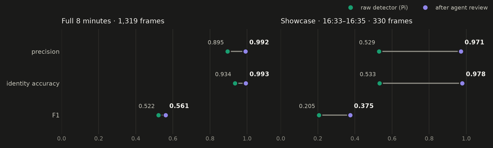
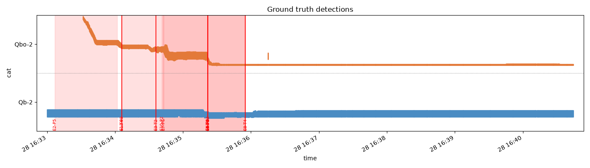
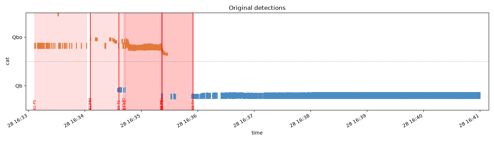
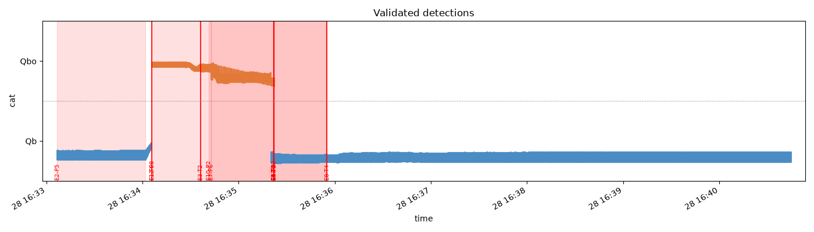
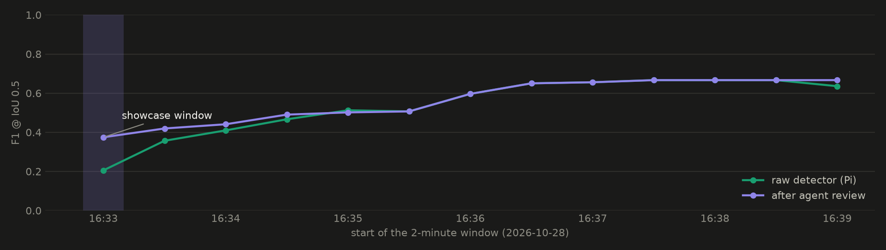
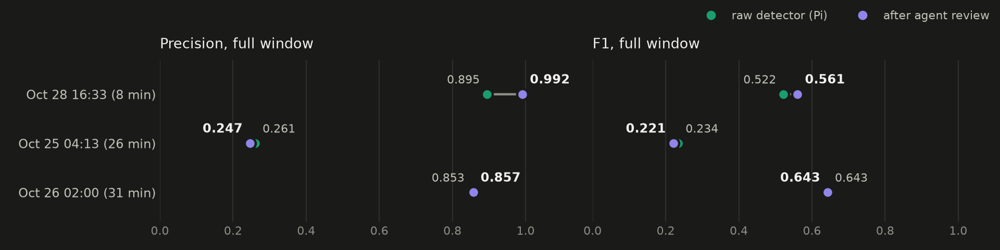

# Final model performance: agentic review on a small detector (2026-11-04)

**Question:** a small detector on a Raspberry Pi is cheap but makes mistakes. Does sending only
its doubts to the Muse Spark agent make the output trustworthy, and at what cost?

**Answer, on the demo run** (`view3_20261028-1633_1640_replay_db_20261104-140502-443911`,
8 minutes, 1,319 frames, both cats on camera):

| | Raw detector (Pi) | After agent review | Change |
|---|---|---|---|
| Precision @ IoU 0.5 | 0.895 | **0.992** | +0.097 |
| False positives | 107 | **8** | **−93%** |
| Identity accuracy (right cat, when the box is right) | 0.934 | **0.993** | +0.059 |
| F1 @ IoU 0.5 | 0.522 | **0.561** | +0.039 |
| Share of what the camera saw that ends up correctly labeled | 93% | **99%** | +6 pts |
| Agent cost for the window | — | **$0.39** (12 doubts, 5 calls) | ~63× cheaper than AI on every frame ($24.65) |

**Showcase window** (selected by a fixed rule, see §3): **16:33–16:35**, the stretch where the
tracker called the sleeping Qb "Qbo". Precision 0.529 → **0.971**, identity accuracy 0.533 →
**0.978**, F1 0.205 → **0.375**, false positives 65 → **4**.

**What the review cannot fix:** recall. The detector never boxes about 60% of the cats in the
ground truth (Qbo out of sight in the cat house; Qb asleep in the bed while Qbo walked by), and a reviewer
can only relabel boxes that exist. Recall is a detector problem, out of this project's scope.



---

## 1. What is measured

- **Ground truth:** `image_server/retrieved_images/<hour>/labels/` (validated YOLO labels),
  with the documented corrections in `evaluation/gt_audit.yaml` (`--audit`). Matching is greedy
  per frame at IoU ≥ 0.5 (and 0.75); a box with the wrong cat counts as one false positive plus
  one miss.
- **Raw detector:** `stream.jsonl`, the Pi's YOLO detections replayed from the read-only
  database. **After review:** `validated.jsonl`, the same stream after the trackers' corrections
  and the agent's verdicts, minus tombstones and guessed (interpolated) rows. Only real
  detections are scored; nothing invented counts.
- **Identity accuracy:** of the boxes that overlap a ground-truth cat, the share with the right
  cat. **Ceiling:** the class-agnostic recall of the raw detector, i.e. the share of
  ground-truth boxes the camera boxed at all.
- **Cost:** `agent_run.est_cost_usd` per agent call, counted **once per call** (see §6).

## 2. Demo run, full window

| Stage | P@0.5 | R@0.5 | F1@0.5 | Identity acc. | TP | FP | FN | P@0.75 | F1@0.75 |
|---|---|---|---|---|---|---|---|---|---|
| Raw detector | 0.895 | 0.369 | 0.522 | 0.934 | 909 | 107 | 1,557 | 0.776 | 0.453 |
| Tracker corrections only | 0.919 | 0.362 | 0.519 | 0.920 | 893 | 79 | 1,573 | 0.791 | 0.447 |
| **After agent review** | **0.992** | **0.391** | **0.561** | **0.993** | **964** | **8** | 1,502 | **0.824** | **0.466** |

- **The agent does the lifting, not the tracker.** Tracker rules alone barely move F1 (0.522 →
  0.519) and slightly lower identity accuracy. The agent's 12 verdicts take precision to 0.992
  and identity accuracy to 0.993.
- **Per cat:** Qb precision 0.932 → 0.995 (56 → 4 false positives); Qbo precision 0.742 → 0.973
  (51 → 4).
- **Ceiling:** the camera boxes 39.4% of ground-truth cats at all. After review, 39.1% are boxed
  *with the right name*, 99% of the ceiling (raw: 36.9%, 93%).
- Box geometry is untouched by review (mean matched IoU 0.771 → 0.770), as expected: the agent
  fixes *who*, not *where*.

Timelines for the same 8 minutes (y = cat, red bands = doubts the Pi raised):

| Ground truth | Raw detector | After agent review |
|---|---|---|
|  |  |  |

## 3. Showcase windows (selected, and how)

The full-window numbers above are the result. To show *where* the review earns its keep, every
run was also scored on sliding **2-minute windows** (30 s step). The showcase is the window
with the largest F1 gain among windows with ≥ 300 frames and ≥ 300 ground-truth boxes, so a
handful of lucky frames cannot win. The rule is in `evaluation/final_performance.py`.

| Window | Frames | F1 | Precision | Identity acc. | False positives |
|---|---|---|---|---|---|
| **Oct 28 16:33–16:35** (demo run) | 330 | 0.205 → **0.375** | 0.529 → **0.971** | 0.533 → **0.978** | 65 → **4** |
| **Oct 26 02:06–02:08** | 340 | 0.954 → **0.987** | 0.956 → **0.991** | 0.964 → **0.994** | 15 → **3** |

- **16:33–16:35** is case E2 in the demo: the tracker labeled the cat asleep in the bed as Qbo
  for its whole first visit; the agent reassigned it to Qb ("cool white, smooth sharp outline,
  white paws, no fluffy halo"). One verdict relabels the whole visit: 44 real detections
  (163 rows with the guessed frames) over 16:33:06–16:34:05.
- **02:06–02:08** shows the other end: with a cat walking in good light, the raw detector is
  already strong, and review still removes 4 of every 5 false positives.



The sweep also shows the honest shape of the gain: review helps most where the tracker had a
named doubt (16:33–16:36), and changes nothing where the detector was right (16:36 onward, no
doubts raised). That is the design: the agent is only called when the Pi is unsure.

## 4. Across runs

| Run (replay, 2026-11-04) | Frames scored | Doubts | Calls | F1 raw → reviewed | Precision raw → reviewed | Agent cost |
|---|---|---|---|---|---|---|
| **Oct 28 16:33 (demo)** | 1,319 | 12 | 5 | 0.522 → **0.561** | 0.895 → **0.992** | **$0.39** |
| Oct 26 02:00 | 5,320 | 45 | 20 | 0.643 → 0.643 | 0.853 → 0.857 | $1.63 |
| Oct 25 04:13 | 3,135 | 48 | 18 | 0.234 → 0.221 | 0.261 → 0.247 | $1.75 |



- **02:00:** review gains in the showcase window but is flat over 31 minutes: outside the
  stretches where doubts fired, the reviewed output is the detector's output, so the long
  doubt-free remainder dilutes the gain.
- **04:13:** the ground truth is weak. The audit notes many frames with a clearly visible cat
  but empty labels (04:20–04:26, 04:31–04:35), so correct detections there score as false
  positives, and the run's low precision (0.26) is mostly a label artifact. Not used as a
  headline; treat its numbers as a lower bound.
- Doubt rate is steady across runs at **~1% of frames** (0.9%, 0.8%, 1.1% of frames processed).

## 5. Cost and time

| | Measured AI labeling of every frame | Agent review of doubts only (demo run) |
|---|---|---|
| Frames sent to AI | 1,318 | 40 images, for 12 doubts |
| Cost | $24.65 ($0.0187 a frame) | **$0.39** (5 calls) |
| Time | 66 min with 10 workers | 8.7 agent-minutes |
| Identity accuracy | 0.38 recall on the sleeping cat | 0.993 on what the camera saw |

- AI labeling numbers: `documents/labeling-sam-vs-spark-20261103.md` (same window, SAM 3.1 →
  Muse Spark, Standard pricing).
- Across all three runs: 105 doubts, 43 agent calls, **$3.77** of review for 65 minutes of
  footage (10,970 frames), against ~$205 to label every frame at the measured rate.

## 6. Corrections to earlier numbers

- **Agent cost was double-counted** in `evaluation/evaluate.py` (`collect_cost`) and in
  `documents/evaluation-report-20261104.md`. With merged review, one agent call answers several
  doubts and each of their rows carries the same `agent_run`, so summing per row counts a call
  once per doubt. Fixed in `evaluate.py` (one count per call, plus an `agent_calls` field).
  Corrected totals: **$0.39 / $1.75 / $1.63**, not $0.93 / $3.51 / $2.94.
- The demo slides' timeline (s08) bridges Qb's undetected sleep with interpolated ticks for
  readability. That bridge is drawing only; **none of it is scored here.**

## Reproduce

```bash
# per-run reports (markdown + metrics JSON + charts)
python evaluation/evaluate.py output/tracking_runs/<run> --audit evaluation/gt_audit.yaml
# this document's numbers, sweep and charts -> documents/assets/final-performance-20261104/
.venv/bin/python evaluation/final_performance.py
```
