# Agentic Computer Vision for Real-Time Detection with Memory

**Author: Muyang Lu** · **Hackathon project report** · Meta Global AI
Developer Hackathon 2026 · Indie Developer track · Problem statement: *Build for Your World*

Team: Muyang Lu, Terry Li · Report date: 2026-11-04 · Code state:
commit `4d8db9b` · Measurements: replay runs of 2026-11-02 to 2026-11-04, scored against
hand-validated ground truth

> **In one sentence:** a $100 Raspberry Pi camera that watches our two cats every second of
> the day with a tiny detector, **knows when it is unsure and can say why**, hands only those
> moments (about 1 in 100 frames) to Meta's **Muse Spark** agent, writes each verified answer
> back into its own record, and builds a plain-language memory of what is normal for each cat,
> in each place, at each hour.

> **The result, measured against ground truth:** false alarms fall by **93%** (107 → 8),
> identity accuracy rises from **0.934 to 0.993**, and **99%** of what the camera sees ends up
> with the right name. It costs **$0.39** for eight minutes of footage, about **63× cheaper**
> than having AI label every frame.

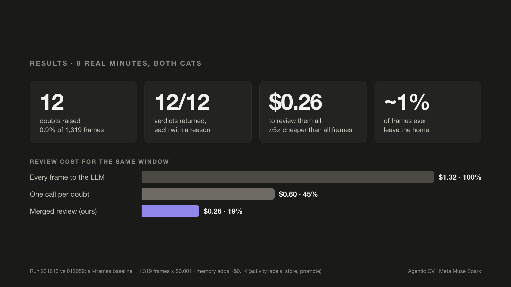

---

## Contents

1. [Executive summary](#1-executive-summary)
2. [Contributions at a glance](#2-contributions-at-a-glance)
3. [The problem we live with](#3-the-problem-we-live-with)
4. [Why it matters beyond one home](#4-why-it-matters-beyond-one-home)
5. [The core insight: fast eyes, slow brain, shared memory](#5-the-core-insight-fast-eyes-slow-brain-shared-memory)
6. [System architecture](#6-system-architecture)
7. [What we built during the hackathon](#7-what-we-built-during-the-hackathon)
8. [Module deep dives](#8-module-deep-dives)
9. [How we use Muse](#9-how-we-use-muse)
10. [Results: measured against ground truth](#10-results-measured-against-ground-truth)
11. [The agent at work: case studies](#11-the-agent-at-work-case-studies)
12. [Cost analysis](#12-cost-analysis)
13. [From failure to fix: root causes we found and closed](#13-from-failure-to-fix-root-causes-we-found-and-closed)
14. [Engineering quality](#14-engineering-quality)
15. [Honest limits](#15-honest-limits)
16. [Competitive landscape](#16-competitive-landscape)
17. [Impact and generalization](#17-impact-and-generalization)
18. [Responsible design](#18-responsible-design)
19. [Roadmap](#19-roadmap)
20. [Demo](#20-demo)
21. [How to run it](#21-how-to-run-it)
22. [Judging criteria map](#22-judging-criteria-map)
23. [Document index](#23-document-index)
24. [References](#24-references)

---

## 1. Executive summary

**The gap.** Computer vision today is split into two halves that fail in opposite ways. A
small detector on cheap hardware sees every frame but understands none of them. A vision
LLM understands a frame but could never afford to see them all: a home camera at 2 frames
per second produces **172,800 frames a day**, and labeling every one with AI cost us
**$0.0187 a frame** in a measured run, about **$3,200 a day** per camera. Bigger models alone
will not close this gap, because the gap comes from **scale**, not intelligence.

**Our answer.** We built a loop that lets the two halves work as one system:

1. A **YOLO nano detector on a Raspberry Pi** watches every frame, all day, for almost nothing.
2. **Correctors** turn boxes into tracks and visits, and they **name their own doubt** at the
   exact decision point where it arises: **15 typed doubt codes** (T1–T7 for frames, P1–P8 for
   visits), plus a heartbeat spot-check.
3. Each doubt becomes a **plain-language question** with key frames, both cats' written
   profiles and a strict JSON answer schema.
4. A **Muse Spark 1.3 supervisor agent** investigates with **39 tools** (camera, stored
   images, tracker state, reference photos, 5 skills), cheapest evidence first, and returns a
   verdict with a written rationale. Related doubts are **reviewed together** in one call.
5. Verdicts **rewrite the tracked record**, and every changed row carries the verdict and the
   escalation that changed it, back to a full trace.
6. A **spatial-temporal memory** turns trusted visits into a day log and a long-term picture
   of each cat ("Qb slept in the green bed 16:34–16:40, confidence 0.92"), which rides along
   with the next question as context.

**What we measured.** On the demo window (view 3, 2026-10-28 16:33–16:41, both cats on
camera, 1,319 frames), scored against audited ground truth at IoU 0.5
([final-model-performance-20261104.md](final-model-performance-20261104.md)):

| | Raw detector (Pi) | After agent review | Change |
| --- | --- | --- | --- |
| Precision | 0.895 | **0.992** | +0.097 |
| False positives | 107 | **8** | **−93%** |
| Identity accuracy (right cat, when the box is right) | 0.934 | **0.993** | +0.059 |
| Share of what the camera saw that ends up correctly named | 93% | **99%** | +6 pts |
| Frames that raised a doubt | — | **12 doubts (0.9%)** | the only time AI is called |
| Agent cost | — | **$0.39** (5 calls) | ~63× cheaper than labeling every frame ($24.65) |

In the hardest two minutes, where the tracker had filed the sleeping Qb under the wrong
name, precision rose from **0.529 to 0.971** and false positives fell from **65 to 4**. Across
three replayed windows (65 minutes, 10,970 frames), doubts stayed at **~1% of frames** and
review cost **$3.77 in total**, against about **$205** to label every frame.

**What it means.** The agent does the work the tracker cannot. Tracker rules alone leave F1
flat (0.522 → 0.519) and *lower* identity accuracy (0.934 → 0.920). The 12 agent verdicts take
precision to 0.992. The system turns a cheap, fallible model into a record you can trust,
and it spends intelligence only where doubt exists.

**Why it matters.** 53 million US households have a cat
([APPA 2025](https://www.petfoodindustry.com/pet-food-market/market-trends-and-reports/news/15834866/report-cat-ownership-grows-to-53-million-us-households)),
cats hide illness, and owners' memories of routine differ from what video records. The same
gap between cheap, constant attention and expensive understanding runs through animal
research, conservation, farms, factories and robotics. **Cats are where we proved it, not
where it ends.**

---

## 2. Contributions at a glance

| # | Contribution | Why it is new | Evidence |
| --- | --- | --- | --- |
| 1 | **Doubt as an interface.** The tracker reports *typed, explained* uncertainty at the decision point (15 codes + heartbeat), instead of a confidence score. | Cascades normally route on confidence. We route on *conflicts in the tracker's own decisions*, which is why only ~1% of frames escalate and why each question arrives already framed. | Doubt rate 0.9% / 0.8% / 1.1% across three runs (§10.4) |
| 2 | **A language bridge with typed contracts.** Each code has its own prompt builder and a slim pydantic schema, so numbers leave as prose and come back as data. | Verdicts are not chat answers. They are schema-checked operations that a handler applies to rows, with provenance on every row. | 12 of 12 verdicts parsed and applied in run 140502 (§8.6) |
| 3 | **Joint review of related doubts.** A batching queue merges doubts that are close in time into one agent call with a schema built at runtime. | Doubts cluster. Reviewing them together lets the agent reason across cases, fetch each frame once and stay consistent. | 12 doubts → 5 calls; tokens −36%, cost −35% vs one call each (§10.5) |
| 4 | **An agent-steerable camera.** An MCP server beside the always-on loop lets the agent capture, zoom, re-detect and reschedule, with every override expiring in 24 h. | The edge device becomes a tool the agent can direct, not just a source of frames. | 24 MCP tools across camera, images and tracking (§8.1) |
| 5 | **Spatial-temporal memory with a trust gate.** Plain-language memory organized by *where* (cells → zones → view) and *when* (5 min → hour → day → week), with anti-overfitting promotion rules enforced in code. | Agent frameworks store memory as conversation. Video needs memory indexed by place and time, protected from noise. | Low-confidence visits refused; activity labels at 0.92; ~$0.14 a session (§10.7) |
| 6 | **An honest measurement stack.** SAM 3.1 + Spark ground-truth labeling, a labels-mode replay harness, per-verdict attribution, re-materialization and a documented ground-truth audit. | We can say which verdict fixed or broke which row, and we publish both the as-given and the audited score. | `evaluation/` (§10, §13) |
| 7 | **Root-cause engineering.** Every failure the measurements exposed was traced to a cause and closed: decoy zones, a continuity-hijack veto, same-label collisions, id aliasing, appearance-first rulings. | The system improves by diagnosis, not by tuning. | Tracker identity accuracy 0.164 → 0.799 from one veto; no verdict broke a single row in the final runs (§13) |

---

## 3. The problem we live with

We live with two cats, **Qb** and **Qbo**. On a workday we see them for two or three hours.
The rest of their day is invisible, and we want to answer simple questions about each cat:

- When did he eat, and when did he use the litter box?
- When did he sleep, and for how long?
- When did he play, and for how long?
- How does today compare with his normal month or year?

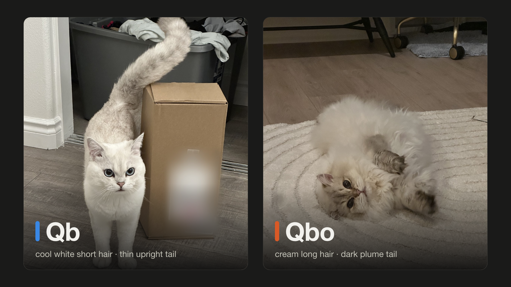

We built a smart camera for this before the hackathon. It exposed three problems that no
off-the-shelf product solves together:

| Problem | What we saw in our own data |
| --- | --- |
| **Small models miss and confuse our cats** | In a recorded audit (Oct 31), a cat asleep in its green bed was plainly visible, yet the custom detector returned nothing and generic `yolov8s` found only a bicycle, balls and the sofa. The detector boxes only **about 40%** of the cats in the ground truth at all. |
| **Confident errors look like perfect evidence** | An exercise ball was tracked as "Qbo" for **26 minutes** with **100% detector agreement**. Its box moved 0.7 px in that time. |
| **24/7 monitoring has to run on cheap hardware** | A Raspberry Pi 5 CPU sustains only a nano-class YOLO in real time ([Ultralytics](https://docs.ultralytics.com/guides/raspberry-pi)); a Pi 5 with an AI HAT draws [6–8 W](https://sixfab.com/blog/raspberry-pi-5-ai-hat-benchmark-deepx-vs-hailo/). |
| **Sending every frame to AI costs too much** | Measured: **$24.65** to detect and identify every frame of an 8-minute window (1,318 frames) with SAM 3.1 + Muse Spark. |

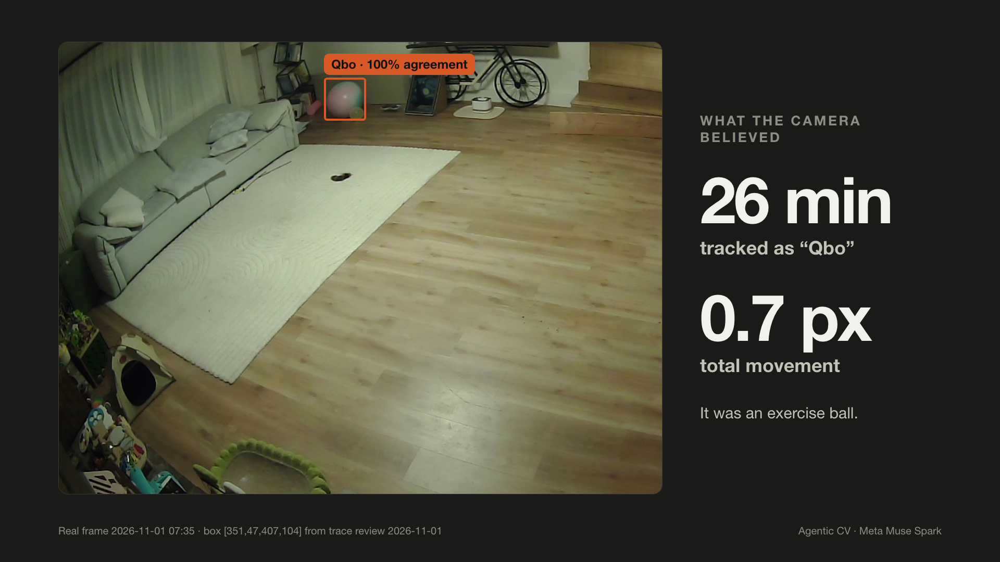

Two near-identical white cats make this harder than usual. Qb is a cool-white short-hair with
a smooth outline, white paws and a thin ringed tail. Qbo is a cream long-hair with a golden-brown
face mask, brown paws and a dark plume tail. At 800×600 from a wide-angle ceiling camera, a
small detector often cannot tell them apart. A vision LLM can, *if someone tells it where to
look and what to compare*. That sentence is the design brief of this project.

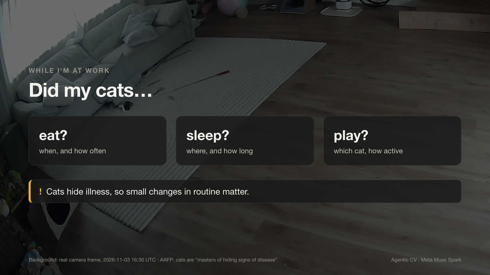

---

## 4. Why it matters beyond one home

### 4.1 Cats hide problems, and owners miss slow changes

- The American Association of Feline Practitioners calls cats ["masters of hiding signs of
  disease and pain"](https://catvets.com/wp-content/uploads/2024/01/AAFPSeniorCareBrochureBW.pdf),
  and treats changes in routine as a possible sign of pain.
- Owners' recall differs from video: guardians reported **lower** urination frequency than
  video showed. Healthy cats made 1–7 litter box visits a day across 6,555 daily records from
  37 cats ([Shin et al., 2024](https://koreascience.kr/article/JAKO202414243207275.pdf)).
- Chronic kidney disease is common in older cats. In one screening of apparently healthy older
  cats, **15% of cats over 10** had stage 2+ CKD ([PubMed 24217707](https://pubmed.ncbi.nlm.nih.gov/24217707/)).
  Behavioral monitoring of 136 cats found patterns linked to CKD
  ([dvm360 on Purina/Ohio State](https://www.dvm360.com/view/smart-litter-box-monitoring-identifies-behavioral-patterns-associated-with-feline-ckd)).

**Our claim, stated carefully:** long-term, per-animal records give owners and vets better
information. They prompt a call to the vet; they are not a diagnosis. The hackathon rules ban
AI medical advice, and we agree with that rule.

### 4.2 The audience is large and growing

- **53 million US households (39%)** own a cat, up 5% year over year
  ([APPA via Petfood Industry](https://www.petfoodindustry.com/pet-food-market/market-trends-and-reports/news/15834866/report-cat-ownership-grows-to-53-million-us-households)).
- Households with **two cats grew 7%** in a year, and those with **three or more grew 45%
  since 2018** ([APPA 2025 Dog & Cat Report](https://americanpetproducts.org/news/the-american-pet-products-association-appa-releases-2025-dog-cat-report)).
  Multi-cat homes are exactly where "which cat was it?" matters.
- AI pet cameras are an active, growing category, estimated at $389M in 2024 with 13.4% annual
  growth ([Market.us](https://market.us/report/ai-pet-camera-market/)). Market estimates vary
  widely by definition, so we treat this as direction, not size.

### 4.3 Cats are mostly still, so few frames need expensive thought

A 28-cat accelerometer study found cats active about **3%** of the day and lying or sitting
about **74%** ([AVSAB summary of Smit et al., 2024](https://avsab.org/can-computers-tell-us-what-cats-do-all-day/)).
This is why a doubt-driven cascade fits: most frames are easy, and the hard moments are rare
and clustered. Our measured doubt rate, ~1% of frames, matches that structure.

---

## 5. The core insight: fast eyes, slow brain, shared memory

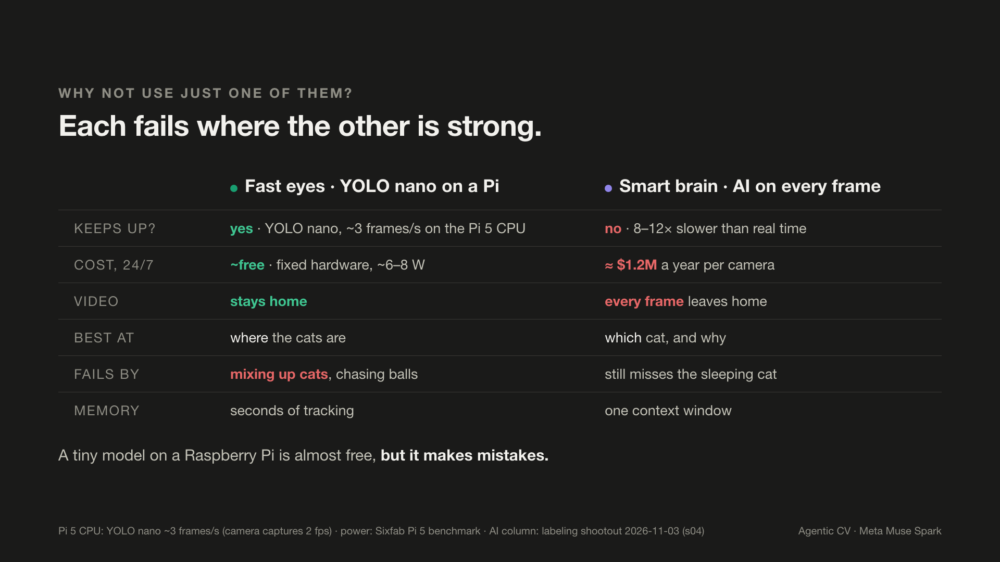

| | Real-time detector (YOLO nano on a Pi) | Vision LLM (Muse Spark) |
| --- | --- | --- |
| Speed | Every frame, in real time | ~30–110 s per agentic review in our runs |
| Cost of running 24/7 | Fixed hardware, ~6–8 W | Measured $0.0187 a frame to label everything |
| Scope | Only its trained classes | Any question in plain language |
| Best at | *Where* things are, frame after frame | *What* things mean and why |
| How it fails | Misses, swaps identities, trusts decoys | Can hallucinate; cannot watch everything |
| Memory | Seconds of tracking | A context window, not months of video |

The fast model sees the moment without understanding it. The smart model could understand
it but never sees it. About 770 million surveillance cameras existed in 2019
([CNBC/IHS Markit](https://www.cnbc.com/2019/12/06/one-billion-surveillance-cameras-will-be-watching-globally-in-2021.html));
no improvement in model quality makes it affordable to send all of them to an LLM.

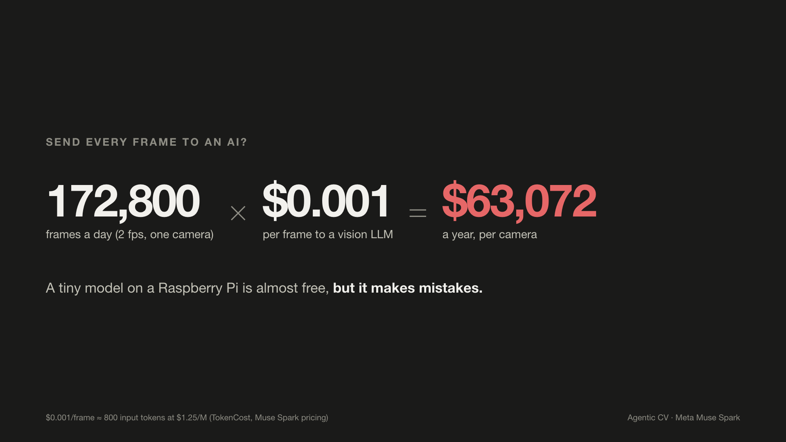

Three things have to cross the gap, and this project builds all three:

- **Attention flows up.** The fast model finds the moments that deserve expensive thought,
  and it says *why* (15 typed doubt codes).
- **Knowledge flows down.** The agent's verdicts correct the record now. They also become
  ground truth for retraining the same small edge model.
- **Memory spans both.** Plain-language history makes "unusual" mean unusual *for this cat,
  in this room, at this hour*.

**Scope, stated plainly.** A larger detector trained on a large labeled dataset would see
better, but it needs GPUs and hardware this setting does not have. We take the small model as
a given and make its output trustworthy with AI, which is the problem every compute-limited
and privacy-bound deployment actually faces.

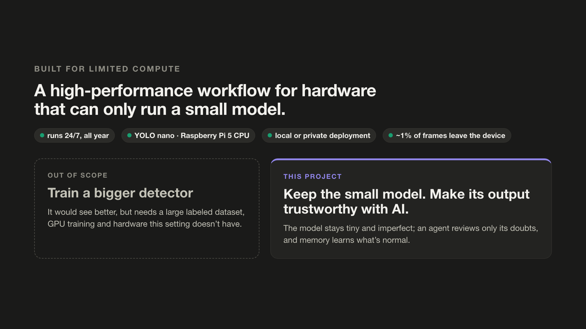

Prior work covers each piece on its own. Specialized cascades
([NoScope](https://web.cs.ucla.edu/~ravi/CS239_W20/papers/noscope.pdf)), online distillation
from a costly teacher ([Mullapudi et al.](https://arxiv.org/pdf/1812.02699)), cascaded VLM
anomaly detection ([Cerberus](https://arxiv.org/pdf/2510.16290)) and agentic memory for long
video ([Avas](https://arxiv.org/html/2505.00254v3)) all exist. Within our targeted review, no
project joins **self-reported, typed doubt**, **agentic review that rewrites the record** and
**spatial-temporal memory** into one loop on a $100 device for long-term tracking of named
individuals.

---

## 6. System architecture

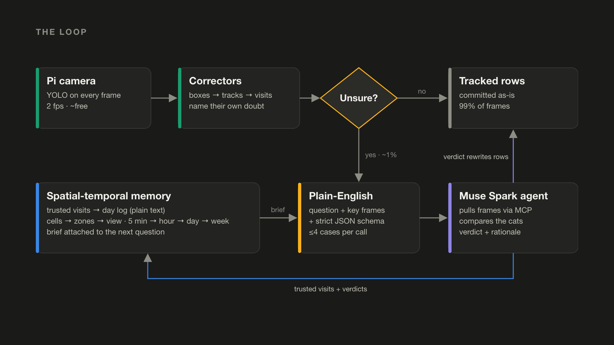

```
  Raspberry Pi (home)                   ingest / pipeline host                     cloud
 ┌───────────────────────┐  JSON over  ┌──────────────────────────────────────┐
 │ camera_v3             │  WebSocket  │ agent.main  (TrackingRun)            │
 │  always-on YOLO 2 fps ├────────────►│  ingest: window, min-conf, decoy zone│
 │  frame buffer         │   :8000     │  TrackCorrector  ── T1..T7 ─┐        │
 │  MCP server :8765 ◄───┼──────┐      │  PeriodCorrector ── P1..P8 ─┤  H1    │
 └───────────────────────┘      │      │                             ▼        │
 ┌───────────────────────┐      │      │  EscalationBatcher (≤60 s, ≤4 cases) │
 │ image_server (SSD+S3) │      │      │        │ background thread           │
 │  MCP :10001  ◄────────┼──────┤      │        ▼                             │   ┌──────────────────┐
 └───────────────────────┘      │      │  ValidationWorker ──────────────────────►│ Muse Spark 1.3   │
 ┌───────────────────────┐      │      │   prompt + memory brief + JSON schema│   │ Meta Model API   │
 │ tracking_mcp :10002 ◄─┼──────┤      │        │ verdict + rationale          │◄──┤ (Responses API)  │
 └───────────────────────┘      │      │        ▼                             │   └──────────────────┘
                                │      │  materialize → validated.jsonl/.db   │            ▲
                                │      │                                      │            │
                                │      │  Memory (own worker thread)          │            │
                                │      │   PeriodLabeler (vision, activity) ──┼────────────┤
                                │      │   short-term day log (.md)           │            │
                                │      │   long-term spatial-temporal YAML ───┼────────────┘
                                │      └──────────────────────────────────────┘   store / promote
                                │
                                └──── MCP tools ◄── supervisor agent (also usable as a chat CLI)
```

**Design rules that hold everywhere:**

- **Tracking never waits for an LLM.** Validation and memory each run on their own background
  thread, and every memory hook is best-effort.
- **One message shape.** Live camera, recorded `stream.jsonl`, read-only MySQL replay,
  ground-truth label folders and `camera_sim` all feed the same `process_message()`, so any
  recorded window replays bit-for-bit.
- **Language out, structure back.** Every doubt leaves as prose and comes back as a
  schema-checked verdict that a handler applies to rows.
- **Everything is auditable.** Every agent run writes a `trace.md` with the system prompt,
  each tool call and result, the evidence images, tokens, cost and time. Every memory LLM call
  writes its own trace. Every agent and tool invocation is logged to the project database.

The full data path, with code pointers, is in [end-to-end-flow.md](end-to-end-flow.md).

---

## 7. What we built during the hackathon

The rules require a clear line between earlier work and event work. The building period was
**Oct 27 – Nov 4**. The repo has **77 commits** since Oct 27, adding about **48,600 lines**.
Pre-hackathon code lives in a separate, clearly marked folder
(`existing_work_before_hackathon/`).

| Existed before Oct 27 | Built during the hackathon |
| --- | --- |
| WebSocket ingest server | **Agent ported from OpenAI to Meta Muse Spark** (Responses API), with a workaround for chained-image turns (§9.4) |
| TrackCorrector and PeriodCorrector (2025) | **15 typed doubt codes** wired into both correctors (T1–T7, P1–P8) plus the **H1 heartbeat** spot-check |
| First tracking MCP server and visualization (Oct 23–25) | **Per-code prompt builders and pydantic verdict schemas**, memory brief attached to each prompt |
| First camera/image MCP servers and the OpenAI-based agent (Oct 24–25) | **Doubt → agent → verdict → validated rows** loop with per-row provenance |
| | **Batching queue** that merges close doubts into joint calls with a runtime-built schema |
| | **Spatial-temporal long-term memory** with trust gate and anti-overfitting promotion |
| | **Daily short-term memory** and **vision activity labeling** of visits |
| | **camera_sim**: replays archived frames through the real camera interface |
| | **High-res capture + S3 upload**; image server serving S3 for new captures |
| | **Read-only MySQL replay**, in-pipeline `original / revised / validated` charts, process MP4 |
| | **Ground-truth labeling** with SAM 3.1 + Spark, and a **labels-mode replay** that exports validated ground truth |
| | **Evaluation stack**: `evaluate.py`, `attribute.py` (which verdict fixed which row), `rematerialize.py`, `final_performance.py`, and a documented ground-truth audit (`gt_audit.yaml`) |
| | **Root-cause fixes** from measurement: decoy zones, the `detector_insists()` continuity veto, same-label collision handling, cat-id aliasing, appearance-first P6 rulings (§13) |
| | **Agent and tool invoke logging** to the database, with a fleet report |
| | Two trace reviews that became fixes: slimmer tools, skill gating, chat budgets, raw-pixel grounding, an explicit decoy rule |
| | YOLO dataset export with database pre-labels |
| | A 3-minute demo with 22 slides, 3 generated clips, narration and captions, all built from real frames and measured numbers by script (`documents/demo-claude/`) |

---

## 8. Module deep dives

### 8.1 An agent-steerable camera

A Pi cannot run a large model at full resolution all day, so the stream runs at 800×600 with
a small custom model (`best.pt`, whose classes are the cats themselves). `camera_v3` keeps
that always-on loop and adds an **MCP server beside it**, so the agent can look harder only
when it needs to:

| Tool | What it gives the agent |
| --- | --- |
| `get_status` | Current settings, frame rate, last detections, models |
| `capture_frame` | Newest or buffered frame, optional crop |
| `capture_high_res` | One sharper still (digital zoom via crop); pauses detection ~3 s |
| `detect` | One pass with any model, region, input size or threshold, without touching the tracker |
| `get_track_history` / `get_track_frame` | When each track was seen, identity flips, first/last frames |
| `list_buffered_frames` / `get_camera_modes` / `list_models` | What can still be revisited, and with what |
| `set_schedule` / `reset_schedule` | Temporary change to frame rate, region, input size or model |

Every override **expires within 24 hours**. With no MCP traffic, the camera behaves exactly as
before. The agent's full toolbox is **39 tools**: 24 MCP tools across three servers (camera,
stored images, tracking), 10 local helpers over a knowledge folder (cat profiles, reference
photos, contact sheets, trajectory physics, labels, zones) and **5 skills**
(`validate-cat-identity`, `check-trajectory`, `check-live-detections`, `assign-activity-label`,
`manage-labels`) loaded on demand.

### 8.2 The correctors name their own doubt

**TrackCorrector** keeps a ~15 s buffer, so later frames can fix earlier ones. It removes
duplicate boxes (IoU > 0.7), keeps or relabels each box against each cat's history,
interpolates toward a trusted future box and commits older rows. A jump over 300 px starts a
new visit. **PeriodCorrector** votes on each whole visit using certainty, frame count,
detection rate and spread, and enforces that **one cat cannot be in two overlapping visits**.
How both work is explained in [how-track-correctors-work.md](how-track-correctors-work.md).

The hackathon contribution is that both correctors now **report their uncertainty at the
exact decision point** where it arises:

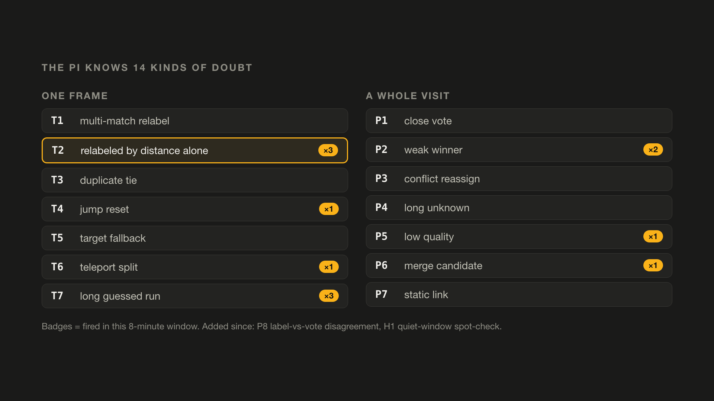

| Frame scope | Trigger | Visit scope | Trigger |
| --- | --- | --- | --- |
| T1 multi-match relabel | Box fits 2+ cats' histories | P1 close vote | Top-two scores nearly tied |
| T2 weak-rule relabel | Relabeled by distance alone, no overlap | P2 weak winner | Barely above minimum, or short visit |
| T3 duplicate tie | Duplicates removed on near-tied confidence | P3 conflict reassign | Top cat taken by an overlapping visit |
| T4 jump reset | New box missed the anchor; buffer wiped | P4 long unknown | Long visit with no cat |
| T5 target fallback | Nothing confident; tracker guessed | P5 low quality | Low confidence or mostly guessed frames |
| T6 teleport split | Committed box jumped > 300 px | P6 merge candidate | May continue the cat's previous visit |
| T7 long synthesis | Long run of interpolated frames | P7 static link | Sleeping cat split by a long gap |
| | | **P8 tracker-vote split** | The tracker's frame labels disagree with the visit's vote: a possible handover |
| **H1 quiet spot-check** | No doubt for a while; sample the quiet window | | |

A low-confidence box does **not** trigger a review by itself. These rules fire on conflicts in
the tracker's *decisions*, which is why the escalation rate stays near 1%, and why each
question arrives with its own explanation. One real example per code, with the full prompt
and schema, is in [escalation-prompt-examples-20261101.md](escalation-prompt-examples-20261101.md).

### 8.3 From numbers to a question, and back

Raw tracker output (boxes, timestamps, scores) means nothing to an LLM. Each code therefore
has its own **prompt builder**, which states the conflict, the question, the alternatives, the
key frames to inspect and each cat's written appearance. It frames the Pi's YOLO honestly, as
*"a hint, not evidence"*, and attaches a memory brief marked *"may help, may be stale"*.

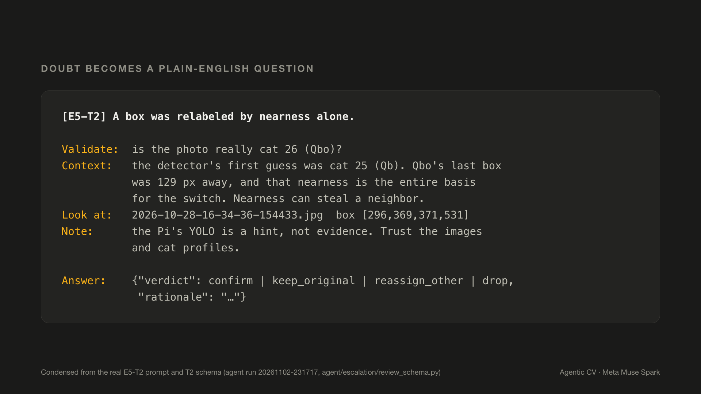

Each code also has a **slim pydantic schema**: one `verdict` enum, at most one qualifier
(`chosen_cat_id` or `cut_time`) and a short `rationale`. Structured output keeps generation
short, and `parse_review()` turns any malformed answer into `{"verdict": "error"}` instead of
an exception. Identity-changing verdicts (P5, P6) must quote the appearance cues they rely on
and keep the camera's label unless appearance rules it out.

### 8.4 The supervisor agent

The agent is a tool-calling loop over the three MCP servers and local helpers, running on
**Muse Spark 1.3**. Its system prompt sets working rules that come straight from our trace
reviews ([agent-trace-review-20261101-003501.md](agent-trace-review-20261101-003501.md)):

- Check cheap sources before pixels, and **stop once the evidence settles the case**.
- Say only what is actually visible, and never invent detections.
- Treat a box that stays still for many minutes as a **possible object (decoy)**.
- Two simultaneous boxes with the same cat id mean one label is wrong.
- Use generic detectors to check for objects, never for cat identity.

For identity, the `validate-cat-identity` skill defines an **evidence ladder** with image
budgets: metadata, then written profiles, then a sharper view, then owner photos, then
confirmed crops, and finally asking a human rather than forcing a call. In the pipeline the
agent gets a narrow set of three tools (`images__get_image`, `images__list_images`,
`tracking__get_period_detail`), which cuts the tool-schema tokens sent on every turn.

### 8.5 A queue that merges related doubts

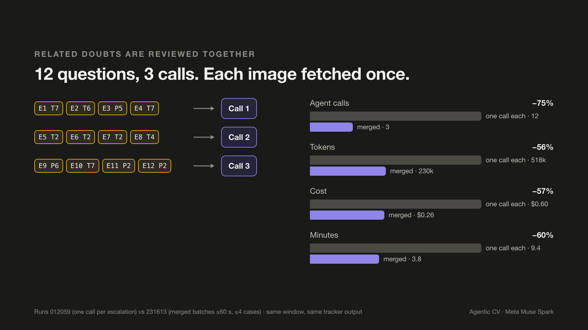

Doubts cluster in time: in the demo run, E4, E5 and E6 all fired on the same frame. The
`EscalationBatcher` lets a new doubt join the waiting batch if it falls **within 60 s**, up to
**4 cases** and about **12,000 prompt characters**. The worker takes the next batch the moment
it is free, so merging **adds no latency**. One agent call reviews all cases together,
fetching each frame once, and returns **one verdict per case** in a schema built at runtime
from the union of the cases' verdict sets. Parsing is **isolated per case**: one malformed
item becomes an `error` for that case only, and its siblings still apply. Design:
[escalation-merge-design.md](escalation-merge-design.md).

### 8.6 Verdicts become data

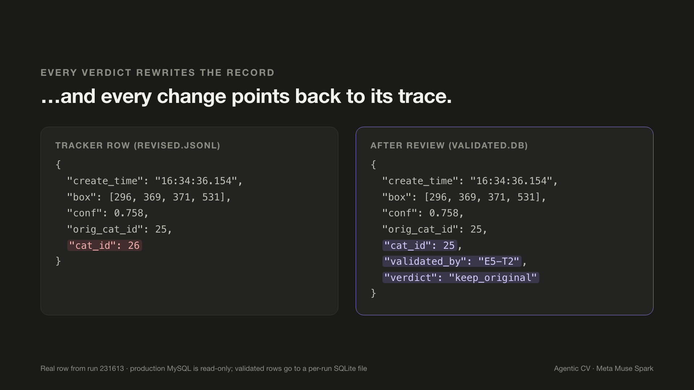

At the end of a run, `materialize()` applies verdicts to the revised rows. Frame verdicts
match rows by timestamp and cat; period verdicts match by visit. `keep_original` restores the
detector's label, `reassign` and `merge` rename whole visits, `cut_at_gap_start` removes
guessed rows, `drop` removes boxes, and `confirm_*` / `keep` stamp rows as confirmed. **Every
touched row records `validated_by` and `verdict`**, so each correction can be audited back to
its trace. Verdicts that cannot be applied precisely keep the rows and record a note instead
of guessing. The output goes to `validated.jsonl` and a per-run SQLite `validated.db`; the
shared MySQL is never written.

In the demo run, 12 verdicts touched **1,304 rows**: one `reassign` renamed 163 rows of the
sleeping cat's visit, a `merge` renamed 39, and a `different_cats` ruling kept Qb's 795-row
visit separate from Qbo's.

### 8.7 Spatial-temporal memory

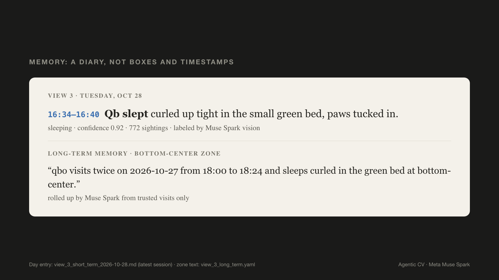

Detectors see frames and trackers see paths, but neither knows that *Qb usually naps in the
green bed in the afternoon*. Agent frameworks treat memory as conversation history; video
needs memory organized by **where** and **when**.

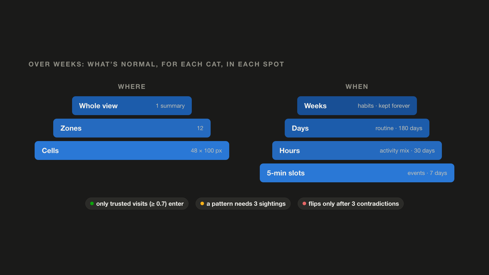

- **Visits, not frames.** Closed visits by the same cat less than 5 minutes apart merge into
  one activity record. A **Muse Spark vision call** (`PeriodLabeler`) labels the key frames
  with an activity from a configurable set (sleeping, resting, sitting, walking, eating,
  grooming, playing, …), plus the cat's appearance and the background.
- **Two memories.** The *short-term* day log keeps everything, including weak visits, doubts,
  verdicts and rationales, as readable Markdown. The *long-term* store keeps only **trusted**
  knowledge: the detector and every activity label must reach 0.7. Doubts and raw verdicts
  never enter it directly.
- **Spatial pyramid.** 48 cells of 100 px roll up into 12 zones and then one whole-view
  summary, each holding plain text about environment, contrast, activity, appearance and
  behavior, plus visit counts per cat.
- **Temporal pyramid.** 5-minute slots hold events (kept 7 days), hours hold the activity mix
  (30 days), days hold routine (180 days) and weeks hold habits (kept indefinitely).
- **Resistance to noise.** A pattern needs ≥3 observations to enter stable text. One-offs live
  in a 5-item recent buffer. Stable text flips only after **3 consecutive contradictions**, and
  word caps force each summary to keep only its strongest patterns. The LLM judges whether new
  evidence contradicts the stable text; *code* does the counting, so the rules are testable
  offline.
- **Targeted retrieval.** Each doubt family asks memory a different question: T1/T2/T5 ask
  whether the cat is hard to see here, P3 asks which cat is usually here now, and P6/P7 ask
  whether this is the usual nap spot. The answer is a brief of at most 600 characters. Memory
  informs the agent but **never overrides the image**.

Real output from the day log:

```text
16:34–16:40: Qb (cat 25) — 772 sightings, mean confidence 0.71.
Activity: sleeping (confidence 0.92). Looks: qb is a white fluffy cat curled up tight
in a small green bed with eyes closed and paws tucked in. Background: light brown wood
floor with a large white ridged rug and a light gray couch along the window wall.
```

Designs: [short-term-memory-design.md](short-term-memory-design.md),
[spatial-temporal-memory-design.md](spatial-temporal-memory-design.md).

---

## 9. How we use Muse

Muse is not one dependency in this project; it is the toolchain that built it and the model
family that runs it. We split work across Muse models by reasoning depth and latency, and we
built the system itself inside Muse Code.

### 9.1 Muse Code is our development environment

- **Project development.** The pipeline, correctors, supervisor agent, memory system and
  tests were implemented in Muse Code, in small verified steps (a focused failing test first,
  then the fix).
- **Brainstorming and design.** Architecture exploration happened conversationally with Muse
  before any code: the doubt taxonomy, the verdict contracts and the spatial-temporal memory
  all started as argued design notes.
- **Design docs and report writing.** Specs, runbooks, session reports and this report were
  drafted and revised in Muse Code alongside the code they describe, so documentation cannot
  drift far from the implementation.
- **Voice input.** Muse Code's voice function let us speak design and thoughts out loud and
  have them land as structured documentation, the fastest way we found to capture a
  half-formed idea before it evaporated.
- **Workflow skills.** Complex, multi-file work ran as Muse workflow skills with focused
  subagents. For example, the escalation system (trigger → prompt → strict schema → verdict
  applier, across six files) was implemented as one orchestrated task.

### 9.2 One family, four tiers of work

| Muse model | Role in this project | Why this tier |
| --- | --- | --- |
| **Muse Wonder** | High-level design: the doubt taxonomy, its prompts and verdict contracts, and the spatial-temporal memory architecture | Deepest reasoning, used rarely and early, where a wrong design costs the most |
| **Muse Spark 1.3** | Main workload. Implementation in Muse Code; at runtime the supervisor agent, the activity labeler, and the memory store/promote/bootstrap engine | Strong multi-turn vision + tool calling at everyday cost; strict `json_schema` verdicts; cached-token pricing |
| **Muse SAM 3.1** | Offline ground-truth labeling: segmentation-first boxes for evaluation and for retraining the edge detector | Mask-true geometry no VLM box regression matches (F1 0.794 vs 0.612 head-to-head) |
| **Muse Glimmer** | Edge deployment: the track corrector and camera server run on the device; a small local Muse model can be invoked on-device so footage never leaves home | Latency and privacy are hard requirements at the edge; deep reasoning stays in the cloud tier |

Runtime usage:

| Where | Meta model | What it does | Status |
| --- | --- | --- | --- |
| Supervisor agent (pipeline) | **Muse Spark 1.3** | Multi-turn, tool-calling **vision** agent: picks frames, compares cats, returns a schema-bound verdict with rationale | Built, measured |
| Joint validation | **Muse Spark 1.3** | Reviews up to 4 related cases in one call with a runtime-built merged schema | Built, measured |
| Activity labeler | **Muse Spark 1.3** (vision) | Labels each visit's key frames with activity, appearance and background | Built, measured |
| Memory store / promote / bootstrap | **Muse Spark 1.3** | Judges contradictions; compresses children into parent summaries under word caps | Built, measured |
| Interactive agent (CLI) | **Muse Spark 1.3** | Chat over live camera, history and tracker ("Is any cat on camera right now?"); custom labels by chat | Built |
| Ground-truth labeling | **SAM 3.1** (+ Spark classify) | Two-stage labels for evaluation and edge retraining | Built, measured |
| Edge inference (camera device) | **Muse Glimmer** | On-device correctors + camera server; local small-model invocation for privacy | Built, measured locally |
| Voice questions | Muse Voice Transcribe | "When did Qbo last eat?" by voice | Planned |
| Daily "cat diary" | Muse Image / Muse Wonder | Creative recap of each cat's day | Planned |
| Private, local reasoning | Muse Spark Open (`muse-spark-open-1026`) | Keep home footage on own hardware | Planned |

### 9.3 Capabilities we relied on

Vision inside tool outputs (images returned in `function_call_output`), multi-turn chaining
with `previous_response_id`, strict `json_schema` structured output including schemas built at
runtime from the union of scenario verdicts, and cached input pricing: across the fleet,
**52% of all input tokens were served from cache** (§10.8).

### 9.4 What we learned about the API

From a controlled probe on Oct 31 ([model-api-chaining-probe.md](model-api-chaining-probe.md)):
chained turns that carry images sometimes return `400 referenced response not found or
expired`. The probe ruled out the root `instructions` parameter, image size and payload size,
and concluded the failure is intermittent on the gateway side. We folded instructions into
turn 1 and recommend retrying with a fallback to unchained history. Other findings: only
`tool_choice: "auto"` is accepted, images must ride inside function outputs, and a very small
`max_output_tokens` returns reasoning only.

**Pricing choice.** Labeling footage on the Contributor tier would have been cheaper, but it
grants permission to train on the footage. Customers' home cameras are not ours to give away,
so all costs in this report are at **Standard** rates.

---

## 10. Results: measured against ground truth

### 10.1 Method

- **Ground truth:** validated YOLO labels per hour
  (`image_server/retrieved_images/<hour>/labels/`), with the documented corrections in
  `evaluation/gt_audit.yaml`. Matching is greedy per frame at IoU ≥ 0.5; a box with the wrong
  cat counts as one false positive **and** one miss.
- **Raw detector:** the Pi's YOLO detections replayed from the read-only database.
  **After review:** the same stream after the correctors and the agent's verdicts, minus
  deleted and interpolated rows. **Only real detections are scored; nothing invented counts.**
- **Determinism:** tracking replays bit-identically, so runs differ only in the agent stage.
- **Cost:** counted once per agent call. (An earlier report double-counted merged calls; the
  correction is documented in [final-model-performance-20261104.md §6](final-model-performance-20261104.md).)

### 10.2 Headline: the demo window

Run `view3_20261028-1633_1640_replay_db_20261104-140502-443911`, 1,319 frames, both cats:

| Stage | Precision | Recall | F1 | Identity acc. | TP | FP | FN |
| --- | --- | --- | --- | --- | --- | --- | --- |
| Raw detector | 0.895 | 0.369 | 0.522 | 0.934 | 909 | 107 | 1,557 |
| Tracker corrections only | 0.919 | 0.362 | 0.519 | 0.920 | 893 | 79 | 1,573 |
| **After agent review** | **0.992** | **0.391** | **0.561** | **0.993** | **964** | **8** | 1,502 |

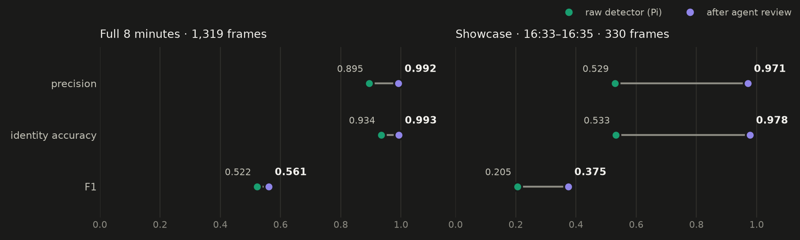

- **The agent does the lifting, not the rules.** Tracker rules alone leave F1 flat and lower
  identity accuracy. The agent's 12 verdicts take precision to 0.992 and identity accuracy to
  0.993.
- **Per cat:** Qb precision 0.932 → 0.995 (56 → 4 false positives); Qbo precision 0.742 →
  0.973 (51 → 4).
- **Ceiling reached.** The camera boxes 39.4% of ground-truth cats at all. After review, 39.1%
  are boxed *with the right name*: **99% of what is reachable**.
- **Geometry untouched** (mean IoU 0.771 → 0.770): the agent fixes *who*, not *where*.

Timelines of the same 8 minutes (y = cat, red bands = doubts the Pi raised):

| Ground truth | Raw detector | After agent review |
| --- | --- | --- |
| 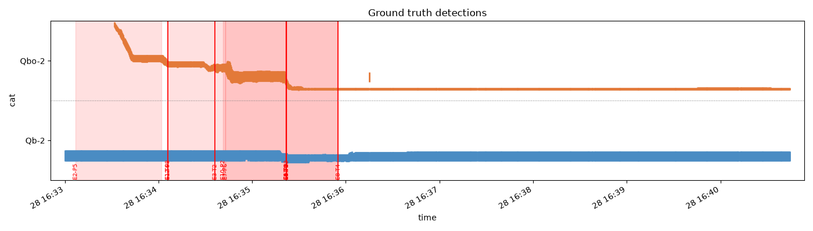 | 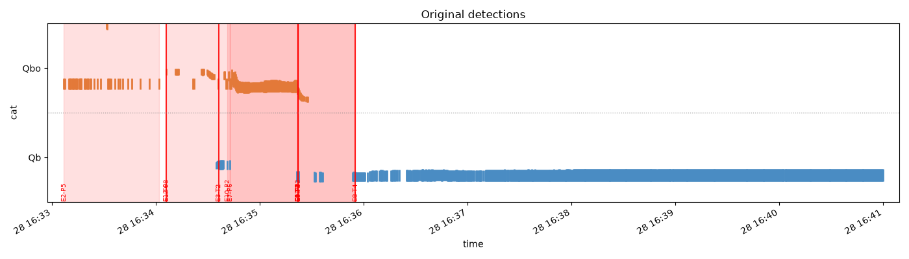 | 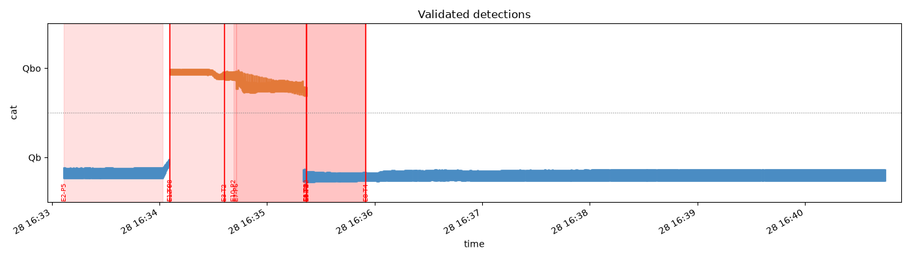 |

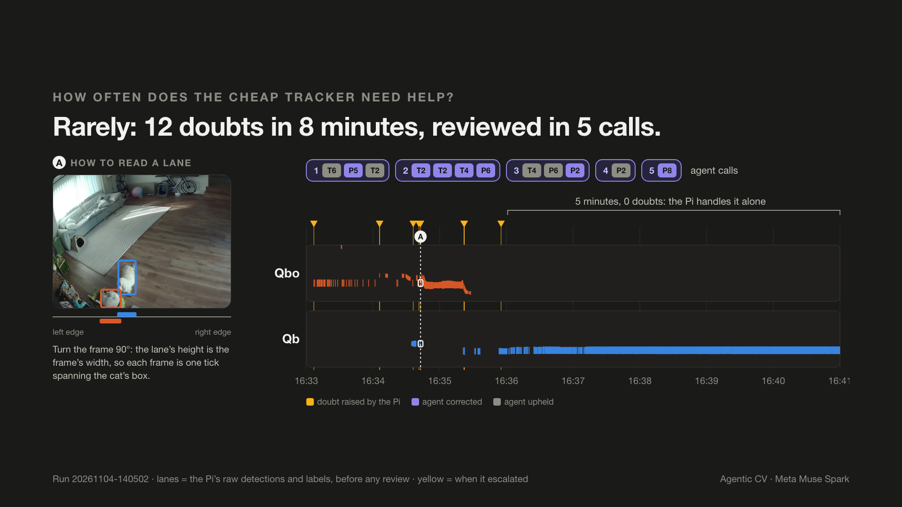

### 10.3 Where the gain lives: showcase windows

Every run was also scored on sliding 2-minute windows (30 s step). The showcase is the window
with the largest F1 gain among windows with ≥ 300 frames and ≥ 300 ground-truth boxes, a
fixed rule in `evaluation/final_performance.py`, so a handful of lucky frames cannot win.

| Window | Frames | F1 | Precision | Identity acc. | False positives |
| --- | --- | --- | --- | --- | --- |
| **Oct 28 16:33–16:35** (demo) | 330 | 0.205 → **0.375** | 0.529 → **0.971** | 0.533 → **0.978** | 65 → **4** |
| **Oct 26 02:06–02:08** (night) | 340 | 0.954 → **0.987** | 0.956 → **0.991** | 0.964 → **0.994** | 15 → **3** |

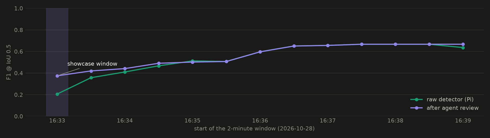

The sweep shows the shape of the design: review helps most exactly where the tracker named a
doubt (16:33–16:36), and changes nothing where the detector was right (16:36 onward, no doubts
raised). **Intelligence is spent where doubt exists, and nowhere else.**

### 10.4 Across runs

| Run (replay, 2026-11-04) | Frames | Doubts | Calls | F1 raw → reviewed | Precision raw → reviewed | Agent cost |
| --- | --- | --- | --- | --- | --- | --- |
| **Oct 28 16:33 (demo)** | 1,319 | 12 | 5 | 0.522 → **0.561** | 0.895 → **0.992** | **$0.39** |
| Oct 26 02:00 (night) | 5,320 | 45 | 20 | 0.643 → 0.643 | 0.853 → 0.857 | $1.63 |
| Oct 25 04:13 (night) | 3,135 | 48 | 18 | 0.234 → 0.221 | 0.261 → 0.247 | $1.75 |

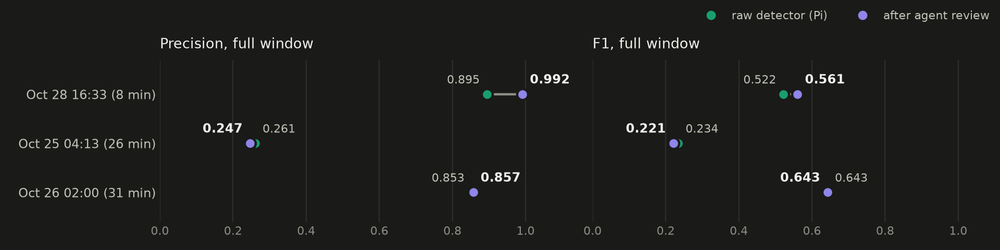

The doubt rate is steady at **~1% of frames** (0.9%, 0.8%, 1.1%). The night runs are flat over
their full length: outside the stretches where doubts fired, the reviewed output *is* the
detector's output, and the 04:13 ground truth misses many visible cats (§15). We report them
because they bound the claim honestly.

### 10.5 Merged review: one call per doubt vs joint review

| Metric | One call each (`012059`, earlier tracker) | Merged (`140502`, current) |
| --- | --- | --- |
| Doubts | 12 | 12 |
| Agent calls | 12 | **5** |
| Tokens | 517.6k | **330.0k (−36%)** |
| Cost | $0.60 | **$0.39 (−35%)** |
| Agent time | 9.4 min | **8.7 min** |
| Verdicts | 11 + 1 API error | **12 of 12** |

The doubts differ between the two code versions, so this is a comparison of practice, not a
controlled ablation. An earlier controlled pair on identical doubts (`012059` vs `231613`) cut
tokens by 56%, cost by 57% and time by 60%
([session-report-20261102-012059.md](session-report-20261102-012059.md)). Merging also makes
the agent *consistent*: cases that share a frame get one coherent reading of who is who.

### 10.6 What the agent decided (run 140502)

| Case | Code | Verdict | Effect | Agent's rationale (shortened) |
| --- | --- | --- | --- | --- |
| E1 | T6 teleport | confirm_split | upheld | Bed cat still in bed while a second cat stands on the rug: two cats, not one fast one |
| E2 | P5 low quality | **reassign → Qb** | **overturned** | Cool white, smooth sharp outline, white paws, no fluffy halo: this is Qb, not Qbo |
| E3 | T2 nearness | confirm | upheld | Fluffy walking cat with a soft halo is Qbo; here the detector was wrong and nearness was right |
| E4 | T2 nearness | **keep_original** | **overturned** | Rug cat: fuzzy halo, bushy plume tail = Qbo; 152 px nearness stole the neighbor's label |
| E5 | T2 nearness | **keep_original** | **overturned** | Bed cat: cool white, smooth outline = Qb; 92 px nearness caused a cross-steal |
| E6 | T4 reset | **link_continuation** | **overturned** | Same fluffy Qbo at both ends; 152 px over 39 s is walking |
| E7 | P6 merge? | **merge → Qbo** | **overturned** | One Qbo visit, not two Qb visits |
| E8 | T4 reset | confirm_reset | upheld | Rug cat (Qbo) left; the new box is Qb in the bed |
| E9 | P6 merge? | different_cats | upheld | A continuous track cannot change from fuzzy halo to smooth outline |
| E10 | P2 weak winner | **reassign → Qbo** | **overturned** | Warm cream, fuzzy halo, darker brown paws: Qbo |
| E11 | P2 weak winner | confirm | upheld | Real rug Qbo, distinct from the bed Qb |
| E12 | P8 vote split | **split_mixed** | **overturned** | Early crops Qbo, tail crops Qb: cut the track at 16:35:19.75 |

**7 of 12 doubts overturned the tracker, and 5 upheld it.** The agent is not a rubber stamp
and not a contrarian: on the three T2 nearness relabels it overturned two and *upheld* one,
because in that case the detector itself had the wrong cat. It judges by appearance, not by
rule.

### 10.7 What memory learned

- **The trust gate held.** A visit at confidence 0.54 was refused from long-term memory with a
  log line, while visits at 0.71 and 0.82 were stored. Error verdicts were refused too.
- **Activity labels landed.** Qb was labeled *sleeping, 0.92* for 16:34–16:40, with appearance
  and background in plain language.
- **Plain-language long-term text** rolled up from cells to zones, the whole view, hour, day
  and week, e.g. *"Most visits happen in the afternoon."*
- **Memory cost** in a measured session was about **$0.14** across 18 traced LLM calls.

### 10.8 Fleet-wide statistics (124 agent runs, 1,058 tool calls)

Every agent and tool invocation from Oct 27 to Nov 3 is logged in the project database
([agent-tool-invoke-report-20261103.md](agent-tool-invoke-report-20261103.md)):

| Metric | Value |
| --- | --- |
| Agent runs (all Muse Spark 1.3, all answered) | 124 (93 validation, 31 interactive) |
| Tool calls across 26 distinct tools | 1,058 |
| Total cost | **$9.22** ($6.56 validation) |
| Tokens in / out / cached | 9.75M / 0.63M / 5.11M (**52% of inputs cached**) |
| Median run | 4 turns, 8 tools, 60 s wall (57 s LLM, 2.6 s tools) |

The log also found a bug no test had: 95 of 104 tool errors were one missing image-library
dependency on the image server. **91 of 95 failures carried a crop box, and 0 of 575 successful
fetches did.** Instrumentation turned a vague failure rate into a one-line fix.

### 10.9 Ground truth: what it costs to label everything

To evaluate honestly and to retrain the edge model, we need labels that are not the
detector's own output. We built two labelers and compared them on the same 1,318 frames
([labeling-sam-vs-spark-20261103.md](labeling-sam-vs-spark-20261103.md)):

| | SAM 3.1 → Spark classify | Spark 1.3 single call |
| --- | --- | --- |
| Wall time (10 workers) | 66 min (3.0 s/img) | 99 min (4.5 s/img) |
| Cost (Standard rates) | **$24.65 ($0.0187/img)** | ~$25.61 ($0.0195/img) |
| F1 @ IoU 0.5 | **0.794** | 0.612 |
| Qb / Qbo recall | 0.977 / 0.380 | 0.821 / 0.310 |

This is the honest baseline for "AI on every frame": **$24.65 and 66 minutes** for eight
minutes of video, and still only **0.38 recall on the sleeping long-haired cat**. Our loop
spends **$0.39 and 8.7 agent-minutes** on the same window and reaches 0.993 identity accuracy
on everything the camera saw. The labeled sets now feed a **labels-mode replay** that pushes
any label folder through the correctors and the agent, and exports validated ground truth
(real sightings only; interpolated guesses never become ground truth).

---

## 11. The agent at work: case studies

### 11.1 Case E2: which cat is asleep in the bed? Overturned.

The tracker called the whole first visit of the cat asleep in the green bed "Qbo". The P5
doubt (mean confidence 0.54, only 29% of frames detected) asked the agent to look. It checked
three frames against both profiles and answered: *"Cool white, smooth sharp outline, white
paws, no fluffy halo. Matches Qb … label 26 is wrong, reassign to 25."* One verdict renamed
163 rows. This single case is the 16:33–16:35 showcase window: precision 0.529 → 0.971.

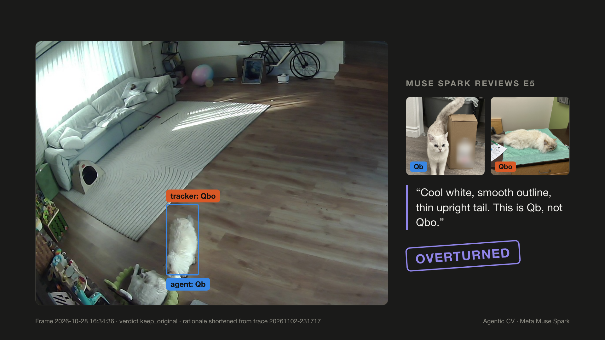

### 11.2 Case E4 + E5: the tracker swapped the cats. The agent swapped them back.

At 16:35:21 the detector named both cats correctly, but the tracker relabeled each one by
distance alone (92 px and 152 px, zero overlap), so the two names crossed. One merged call
reviewed all four related doubts (E4–E7) together and restored both: *"Rug cat: fuzzy halo,
bushy plume tail = Qbo. Bed cat: cool white, smooth outline = Qb. Nearness caused a
cross-steal; the detector was right."*

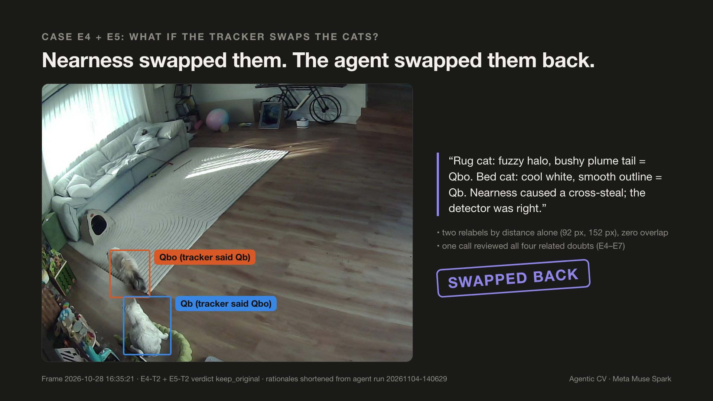

### 11.3 When the detector itself is wrong

The agent does not just police the tracker. In E10 the detector called a standing cat "Qb" on
two weak frames; the agent compared the crop with the owner's reference photos and relabeled
it Qbo (golden-brown face mask, thick neck ruff, brown paws, plume tail). The other failure,
a ball tracked as "Qbo" for 26 minutes, was found in our trace review and closed for good with
a **decoy zone** (§13.1). It is now dropped before tracking: 1,016 false boxes in the 26 Oct
replay, 660 in 25 Oct's.

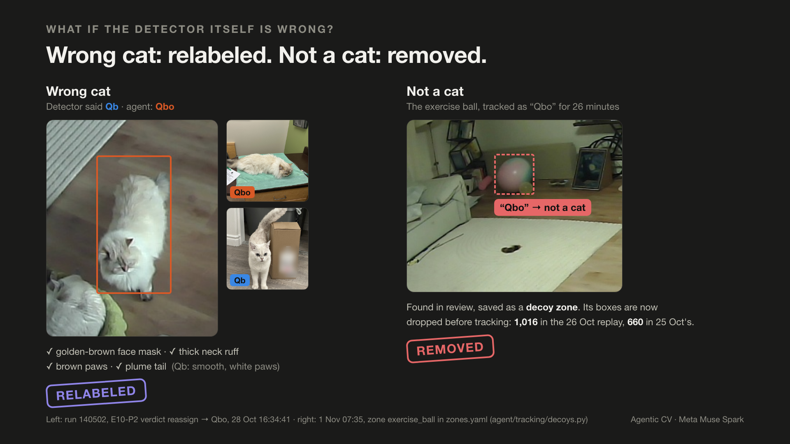

### 11.4 Watching the agent think

Every run leaves a trace with the prompt, every tool call, every image the agent chose and
its final JSON. The demo's screen recording scrolls
`output/agent_runs/20261104-140629-508165-validation/trace.md`: the case prompt, then
`images__get_image` calls with thumbnails, then
`{"verdict": "keep_original", …}`.

---

## 12. Cost analysis

### 12.1 What every-frame AI would cost

| Basis | Per frame | Per 8-min window | Per camera-day (172,800 frames) | Per camera-year |
| --- | --- | --- | --- | --- |
| **Measured labeling** (SAM 3.1 + Spark, detect + identify) | $0.0187 | $24.65 | ~$3,230 | ~$1.18M |
| Input-only floor (~800 tokens at $1.25/M, classify only) | $0.001 | $1.32 | $172.80 | $63,072 |

The floor is the most favorable possible number for every-frame AI. Even there, a single
camera would cost $63,000 a year.

### 12.2 What we spent

| Window | Doubts | Agent calls | Review cost | vs measured labeling | vs input-only floor |
| --- | --- | --- | --- | --- | --- |
| Demo, 8 min | 12 | 5 | **$0.39** | **63× cheaper** ($24.65) | 3.4× cheaper ($1.32) |
| All three runs, 65 min | 105 | 43 | **$3.77** | **~54× cheaper** (~$205) | 2.9× cheaper (~$11) |

Pi detection and the correctors cost nothing beyond fixed hardware. Memory adds about $0.14 a
session.

### 12.3 What a full day would cost

The demo window is a **worst case**: both cats moving, 12 doubts in 8 minutes. Cost scales
with doubts, not frames:

| Doubts a day | Review at ~$0.033 each (demo rate) | Comment |
| --- | --- | --- |
| ~1,700 (1% of every frame, all day) | ~$56 | Upper bound; assumes the busy rate never drops |
| ~400 (busy rate for 4 active hours) | ~$13 | Cats are active or moving about 3–15% of the day |
| 50 | ~$1.65 | Target once memory resolves the easy cases |

Against $3,230 a day for measured every-frame labeling, even the upper bound is **58×
cheaper**. A **full-day run is the next measurement**, and §19 lists the levers that push the
rate down further.

**Privacy is a side effect of cost control.** Only frames attached to a doubt, about 1 in
100, ever leave the home.

---

## 13. From failure to fix: root causes we found and closed

Measuring against ground truth exposed failures that no demo would have shown. Each was
traced to a root cause and fixed in code, with before/after numbers
([e2e-identity-fix-20261104.md](e2e-identity-fix-20261104.md)).

### 13.1 The decoy: a ball that steals a cat's identity

The back-wall exercise ball was detected as Qbo for minutes at a time: 1,016 boxes on 10-26,
660 on 10-25, and the 26-minute incident on 11-01. Stillness cannot separate it from a
sleeping cat (ball p90 movement 1.0 px; Qb asleep 2.8 px), but **place** can: its median box is
the same in all three incidents. Worse, the ball claimed cat 26, so the one-cat-per-time rule
pushed the *real* Qbo onto the wrong name.

**Fix:** zones of `kind: decoy` in `zones.yaml`; `agent/tracking/decoys.py` drops detections
overlapping a decoy at IoU ≥ 0.6 at ingest. A cat lying beside the ball gives a wider box
(IoU 0.3–0.5) and is kept. The agent's zone tools accept the new kind, so a decoy can be
proposed in conversation and confirmed by the owner.

### 13.2 The continuity hijack: Qb filed under Qbo for 772 frames

When Qb settled into the bed where the "Qbo" track had last been, every Qb box overlapped the
Qbo track and was relabeled. Qb's own buffer never refilled, so the hijack fed itself: 762
rows broken. A pre-hackathon guard for exactly this case existed but was commented out, and it
read the wrong column.

**Fix:** `TrackCorrector.detector_insists()` vetoes a continuity relabel X→Y once Y's 15-second
buffer holds ≥ 5 real boxes the camera called X, and at least twice as many as it called Y.
**A single veto took tracker identity accuracy on the demo window from 0.164 to 0.799**; with
the other fixes in this section, tracker F1 rose from 0.110 to 0.535. P8 was added to catch any
handover the veto misses.

### 13.3 Smaller failures, same discipline

| Failure | Root cause | Fix |
| --- | --- | --- |
| Two boxes with one cat id: the last one silently won | Ingest kept one box per id | Keep the more confident box; count `detections_dup_cat` |
| A verdict wrote cat "0" into 13 rows | The agent saw profile ids (Qb 0, Qbo 2) beside view ids (25/26) | `apply_ops` normalizes ids and skips anything ambiguous |
| A P6 ruling renamed a Qb visit without looking at it | "Another visit already has this cat" | P6 must name the cat from its own frames and quote the cues |
| A chat answer validated the ball as a cat | Too many tools, no decoy rule, no grounding | Fewer tools, skill gating, budgets, raw-pixel grounding, decoy rule |
| 95 tool failures | Missing image library behind crop requests | Found from the invoke log in one query |

**In the final runs, no verdict broke a single row on any hour** (`evaluation/attribute.py`).
At baseline, two verdicts alone had broken 682 and 607 rows.

### 13.4 We audited the ground truth too

Drawing the label boxes on the frames wherever the pipeline and the labels disagreed showed
that some "ground truth" was wrong: before 04:19 on 10-25 the labels were the raw detector's
output (the ball as Qbo), and on 10-26 a cat with a dark plume tail was labeled Qb for 619
frames. The corrections live in `evaluation/gt_audit.yaml` with evidence images, and **every
score is published both as given and audited**. We only inspected disagreements, so label
errors the pipeline shares stay invisible; the audited numbers may lean optimistic, and we
say so.

---

## 14. Engineering quality

| | |
| --- | --- |
| Code for the new pipeline | Memory ~4.0k lines, supervisor agent ~3.3k, tracking ~3.3k, camera server ~2.3k, ground-truth labeling ~2.0k, validation ~1.8k, evaluation ~1.5k, escalation ~1.4k, camera simulator ~0.7k (Python, tests excluded) |
| Tests | **48 test files, 472 test functions.** Memory and agent tests run fully offline with a stub LLM and a fake model client. |
| Determinism | Tracking replays bit-identically. Single-case batches produce byte-identical prompts to the unmerged path. Stored verdicts can be re-applied with current code without any LLM call (`rematerialize.py`). |
| Attribution | `attribute.py` says which verdict fixed or broke which rows against ground truth. |
| Observability | One `trace.md` per agent run and per memory LLM call, with tokens, cost, time and evidence images. Each run writes `run.json` with counts by code and verdict. Every agent and tool call is logged to the database. |
| Failure isolation | A dropped MCP server degrades with a warning. An API failure becomes one `error` verdict, never a crash. One malformed case in a merged call never blocks its siblings. Memory failures never reach tracking. |
| Safety of shared data | Production MySQL is read-only. Validated rows go to a per-run SQLite file. |
| Self-review culture | Design documents for each module, two agent-trace reviews, an API probe, per-session reports, an evaluation report, a root-cause report and a ground-truth audit. Each one ended in concrete fixes. |

---

## 15. Honest limits

We would rather show what we found than hide it.

1. **Recall is the ceiling, and it is the detector's.** The Pi boxes about 40% of
   ground-truth cats (Qbo hidden in the cat house, Qb asleep during detector dropouts). A
   reviewer can relabel, drop or interpolate, but it cannot invent sightings. This is the
   stated scope; retraining the same small model on validated ground truth is the next lever.
2. **Silent misses never escalate.** With no detection, no doubt fires. Catching sleeping cats
   needs a different mechanism: periodic sampling in zones where memory says a cat usually
   rests (H1 is the first step).
3. **The agent can be wrong in the dark.** In dim IR frames on 10-25 and 10-26 it sometimes
   read a plume-tailed Qbo as Qb. Merged review, appearance-first rules and memory reduce this,
   but **agent verdicts are evidence, not ground truth**. Self-consistency on row-changing
   verdicts is on the roadmap.
4. **Not every window improves.** 10-25 did not improve end to end (0.234 → 0.221), and its
   ground truth misses many visible cats, so it understates precision. We report it anyway.
5. **Two cats, one detector label.** When the camera calls both cats "26", the tracker can hold
   only one box under that id. This is the largest remaining tracker error.
6. **One window, not a year.** Savings are measured on three replayed windows (65 minutes),
   not on a full day or a season. A full-day run is next.

---

## 16. Competitive landscape

| | Pet cameras (Furbo, Petcube, …) | Smart litter boxes (Litter-Robot 5 Pro, Petlibro Luma, Petkit) | Cloud VLM on every frame | **This project** |
| --- | --- | --- | --- | --- |
| Watches | One room, motion/bark events | Only the litter box | Anything | Whole room, continuously |
| Tells cats apart | Generally not a core feature | Weight or face ID at the box ([Whisker](https://www.techedt.com/whisker-introduces-litter-robot-5-pro-with-ai-facial-recognition-for-cats); [Petlibro](https://ca.petlibro.com/blogs/all/how-does-the-new-luma-smart-litter-box-stack-up)) | Yes, at high cost | Yes: 0.993 identity accuracy on what the camera sees |
| Knows its own doubt | No | No | No | **15 typed doubt codes** |
| Explains decisions | No | No | Sometimes | **Rationale per verdict, full trace, per-row provenance** |
| Long-term memory of routine | Event clips | Per-visit logs | Context window only | **Spatial-temporal plain-language memory** |
| Running cost | Subscription | $899-class hardware + subscription | ~$3,200/day per camera measured | Pi + ~1 in 100 frames to the agent |
| Gets better at *your* home | No | No | No | Verdicts correct records now; validated ground truth feeds retraining |

Litter-box devices measure one important behavior very well, and they complement this
project rather than compete with it. This project covers the rest of the day: sleeping,
resting, playing, and which cat was where.

---

## 17. Impact and generalization

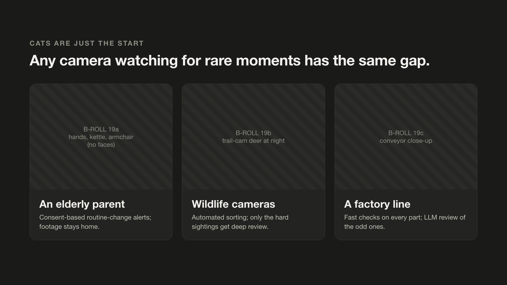

The pattern of a cheap camera that watches continuously, **knows when it is unsure**, asks for
help only then and remembers what it learns fits any setting with **fixed cameras, rare or slow
events, and too much video for people to review**:

| Domain | Today | What this method adds | Demo moment it mirrors |
| --- | --- | --- | --- |
| Animal research | [Home-cage video](https://www.frontiersin.org/journals/behavioral-neuroscience/articles/10.3389/fnbeh.2022.877323/pdf) suffers identity swaps and needs manual correction | Named animals, flagged doubt, written activity logs | Qb vs Qbo, the swapped cats |
| Wildlife conservation | [Manual review took 6–7 months](https://news.wsu.edu/?p=260863) in one study | Automated sorting, with only hard sightings sent to deeper review | ~1% of frames escalate |
| Drones and tiny objects | Small, distant targets and decoys | Typed doubt on decoys and implausible tracks | The ball |
| Traffic in poor visibility | Tracks break and swap in fog and rain | Teleport, reset and merge doubts reviewed with evidence | T4/T6/P6 cases |
| Farms | [Visual scoring is slow and subjective](https://cris.unibo.it/retrieve/handle/11585/1046536/0198d1c4-e7c7-4dbe-b1d7-548678026540/animals-15-02508-v2.pdf) | Per-animal baselines with changes flagged | Spatial-temporal memory |
| Factories | Defects [can be as rare as 0.1%](https://arxiv.org/pdf/2509.05796v1) | Fast checks on every part, agent review of odd ones as training data | Verdicts → ground truth |
| Robots | New situations break trained policies ([Sinha et al.](https://arxiv.org/abs/2407.08735)) | A principled way to know when to stop and think | Doubt as an interface |

The code is built around four replaceable pieces: a detector, a doubt vocabulary, prompts and
memory. Nothing in the loop is specific to cats. Moving to a new domain means adapting those
pieces, with new accuracy and safety evidence for each.

**Path:** pets and homes now, where one person can check every answer. Labs, conservation and
farms next. Robotics and industry later, where reliability needs far more proof.

**The larger idea.** *The AI gives the camera a brain; the camera gives the AI eyes.* With a
small Muse model deployed locally, the same loop can give a personal agent eyes on the
physical things a person cares about, all year round, with nothing leaving the home.

---

## 18. Responsible design

- **Privacy by architecture.** Frames stay on the home network. Only frames attached to a
  doubt (~1%) go to the model API. Memory is plain text the owner can read and delete. Costs
  are at Standard rates, so no footage is licensed for training. Local Muse models are the
  path to keeping even those frames at home.
- **No diagnosis.** The system says "Qb slept 40% less than his usual afternoon". It never
  says "Qb may be sick". A person and a vet decide.
- **Watching people is different.** Any use with people needs clear consent from the person
  watched. The [EU AI Act](https://presencis.com/regulations/eu-ai-act/article-5/) bans some
  uses outright, such as inferring emotions at work.
- **Humans in the loop.** The identity ladder ends with sending the case to a human rather
  than forcing a call, and unreachable evidence is recorded as `unknown`, not guessed.
- **Honest claims.** Shown on two cats in one room, scored against audited ground truth, with
  the as-given score published beside it.

---

## 19. Roadmap

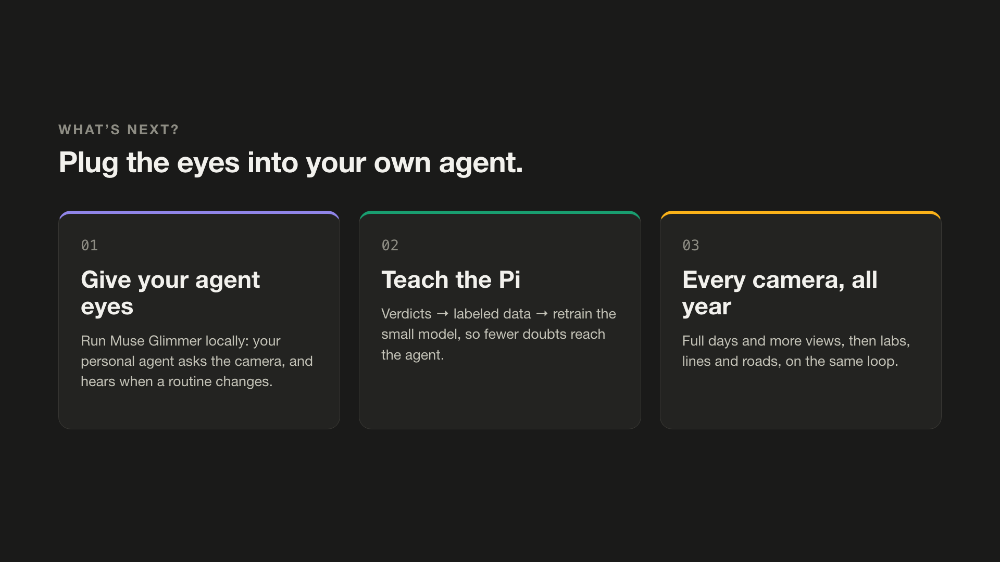

| Priority | Item | Why | Status |
| --- | --- | --- | --- |
| — | Identity-consistency trigger for handovers | Closes the 772-row hijack | **Done**: `detector_insists()` veto + P8 |
| — | Hand-labeled ground truth and a real accuracy number | Replace claims with measurements | **Done**: §10 |
| — | Decoy handling | The ball | **Done**: decoy zones |
| 1 | **Full-day replay** with merging, and real cost per day | Replaces the projection in §12.3 | Next |
| 2 | **Verdicts → validated ground truth → retrain the same small edge model**; measure the doubt rate before and after | Closes the teacher–student loop and lifts recall | Export exists |
| 3 | **Two boxes under one detector label** in the tracker | Largest remaining tracker error | Designed |
| 4 | **Memory tool for the agent**: "When did Qbo eat today?" | Turns memory into the product | Next |
| 5 | **Self-consistency** on row-changing verdicts; retry with unchained fallback on API 400s | Reliability, especially at night | Next |
| 6 | **Memory-only decisions in shadow mode**, then skip images where memory proves reliable | Next cost cut | Planned |
| 7 | **Silent-miss sampler** in usual rest zones, built on H1 | Catches sleeping cats | Started |
| 8 | Adaptive camera policy (agent changes model, region or resolution); night/IR model | Uses camera tools that already exist | Planned |
| 9 | Voice questions, daily cat diary, local Muse models | Broader use of Meta's models; privacy | Planned |

---

## 20. Demo

The 3-minute demo is fully produced from real frames and measured numbers. Everything is in
[`demo-claude/`](demo-claude/):

- **Video:** [`demo-claude/assets/video/final_demo.mp4`](demo-claude/assets/video/final_demo.mp4),
  plus the generated clips `v01_cost_counter.mp4`, `v02_ball_push_in.mp4` and
  `v03_replay_tracker.mp4`.
- **Script:** [`demo-claude/demo-script-claude.md`](demo-claude/demo-script-claude.md): every
  beat with its narration, format, asset, data source and motion notes.
- **Narration and captions:** `demo-claude/assets/text/narration.txt` and `captions.srt`.
- **Slides:** 22 slides in `demo-claude/assets/slides/`, rendered from HTML by
  `demo-claude/scripts/build_slides.py`, which reads boxes from the run's own files rather
  than typing them in. Clips come from `build_videos.py`, text from `build_text.py`.

The story in six moves: two near-identical cats and a ball the camera believed was a cat → the
cost of sending every frame to AI → *we built both* → the loop, 15 kinds of doubt and a
plain-English question → the agent at work (E2 overturned, the swapped cats swapped back,
twelve doubts in five calls) → memory as a diary, the results card, and the world beyond cats.

---

## 21. How to run it

```bash
# full loop on the measured window: replay + agent validation + memory + charts + report
python -m agent.main --view-id 3 \
  --start 2026-10-28-16-33 --end 2026-10-28-16-40 \
  --replay-db --validate --memory --plot --report

# score against ground truth, as given and audited
python evaluation/evaluate.py --run output/tracking_runs/<run> \
  --hour image_server/retrieved_images/2026-10-28-16 --gt-source labels --iou 0.5
python evaluation/evaluate.py ... --audit evaluation/gt_audit.yaml
# which verdict fixed or broke which rows; re-apply stored verdicts with no LLM calls
python evaluation/attribute.py --run <run> --hour <hour> --audit evaluation/gt_audit.yaml
python evaluation/rematerialize.py output/tracking_runs/<run> /tmp/out
# headline numbers, window sweep and charts for this report
python evaluation/final_performance.py

# live, without hardware: simulated camera in one terminal, pipeline in another
python -m camera_sim --start 2026-10-28-16-33-00 --end 2026-10-28-16-59-00
python -m agent.main --view-id 3 --start 2026-10-28-16-33 --end 2026-10-28-16-59 \
  --live --validate --memory --plot

# chat with the agent over camera, history and tracker
cd agent && python -m supervisor_agent "Is any cat on camera right now?"

# label ground truth with SAM 3.1 (+ Spark classification), then replay labels
# through the correctors + supervisor validation and export validated ground truth
python image_server/grounding_truth/label_with_sam.py --start 2026-10-28-16-33 --end 2026-10-28-16-40
python -m agent.replay_labels --view-id 3 \
  --hour-dir image_server/retrieved_images/2026-10-28-16 --labels muse_labels --validate

# tests (offline)
python -m pytest -q
```

Each run writes its rows, verdicts, charts and counts, one agent trace with evidence images per
batch, and one trace per memory LLM call. A Meta Model API key is required for validation and
memory; without one, memory falls back to an offline stub.

---

## 22. Judging criteria map

| Criterion (weight) | Where this report answers it |
| --- | --- |
| **Impact (30%)** | §3 the problem, firsthand · §4 cat health evidence and 53M households · §17 generalization across seven domains · §18 responsible design |
| **Use of Meta AI tooling (25%)** | §9: Muse Code as the development environment (voice input, workflow skills); Wonder for design; Spark 1.3 as a multi-turn vision agent with 39 tools, runtime-built strict schemas, joint multi-case review, vision activity labeling and memory compression; SAM 3.1 for ground truth; Glimmer at the edge; API probe findings |
| **Demo (25%)** | §20 a fully produced 3-minute video built from real frames and measured numbers · §11 case studies · deterministic replay anyone can rerun (§21) |
| **Technical depth (20%)** | §6–8 architecture and modules · §10 ground-truth evaluation · §13 root-cause fixes · §14 tests, determinism, attribution · §15 honest limits |
| Bonus: Best Agentic Use-Case | Doubt-driven escalation, tool choice under image budgets, joint reasoning across related cases, verdicts that rewrite data with provenance, measured −93% false alarms |

---

## 23. Document index

The `documents/` folder holds the design notes, experiments and reports behind every claim in
this report. Start with the first group.

**Results and evaluation**

| Document | What it covers |
| --- | --- |
| [final-model-performance-20261104.md](final-model-performance-20261104.md) | The headline numbers: raw vs reviewed against ground truth, showcase windows, three runs, cost |
| [e2e-identity-fix-20261104.md](e2e-identity-fix-20261104.md) | Why the flow mislabeled the cats, each root cause and its fix, and the ground-truth audit |
| [evaluation-report-20261104.md](evaluation-report-20261104.md) | Three replay runs end to end: doubt burden, verdict balance, issues (its costs are superseded, see the performance report §6) |
| [labeling-sam-vs-spark-20261103.md](labeling-sam-vs-spark-20261103.md) | SAM 3.1 vs Spark 1.3 for ground-truth labeling: accuracy, time and cost of AI on every frame |
| [agent-tool-invoke-report-20261103.md](agent-tool-invoke-report-20261103.md) | Fleet statistics over 124 agent runs and 1,058 tool calls |
| [session-report-20261102-012059.md](session-report-20261102-012059.md) | The first full-loop run, one call per doubt; the baseline for merged review |

**Architecture and design**

| Document | What it covers |
| --- | --- |
| [end-to-end-flow.md](end-to-end-flow.md) | Detection → tracking → escalation → validation → memory, with code pointers |
| [how-track-correctors-work.md](how-track-correctors-work.md) | How TrackCorrector and PeriodCorrector clean up flickering, jumping, swapping detections |
| [escalation-prompt-examples-20261101.md](escalation-prompt-examples-20261101.md) | One real escalation per code, with its full prompt and output schema |
| [escalation-merge-design.md](escalation-merge-design.md) | The batching queue that merges related doubts into joint calls |
| [short-term-memory-design.md](short-term-memory-design.md) | The daily activity log |
| [spatial-temporal-memory-design.md](spatial-temporal-memory-design.md) | The long-term memory: spatial and temporal pyramids, trust gate, promotion rules |
| [tracking-viz.md](tracking-viz.md) | The tracker visualization and replay renderer |

**Experiments and reviews**

| Document | What it covers |
| --- | --- |
| [experiment-20261031-191639-cat-false-negative.md](experiment-20261031-191639-cat-false-negative.md) | The audit where a plainly visible sleeping cat went undetected |
| [agent-trace-review-20261101-003501.md](agent-trace-review-20261101-003501.md) | The review that found the ball validated as a cat, and the fixes it led to |
| [trace-review-20261101-003501.md](trace-review-20261101-003501.md) | The companion review of tools, prompts and skills for the same run |
| [model-api-chaining-probe.md](model-api-chaining-probe.md) | The controlled probe of the API's chained-image 400 errors |

**Project and event**

| Document | What it covers |
| --- | --- |
| [hackathon-guide.md](hackathon-guide.md) | Event rules, dates and judging criteria |
| [project-plan.md](project-plan.md) · [project-plan.zh.md](project-plan.zh.md) | The team's plan for the event (English and Chinese) |
| [demo-claude/demo-script-claude.md](demo-claude/demo-script-claude.md) | The produced 3-minute demo: beats, assets, sources |
| [hackathon-project-report-muse.md](hackathon-project-report-muse.md) | The long-form companion report |

---

## 24. References

**Project measurements.** All figures come from the project's own replay runs, agent traces
and evaluation scripts of 2026-11-02 to 2026-11-04 (demo run
`view3_20261028-1633_1640_replay_db_20261104-140502-443911`; view 3, 2026-10-28 16:33–16:41),
scored against the hour's validated labels with the corrections in `evaluation/gt_audit.yaml`.
They have not been independently verified.

**Cat health, behavior and market**

- [AAFP senior cat care brochure](https://catvets.com/wp-content/uploads/2024/01/AAFPSeniorCareBrochureBW.pdf)
- [Shin et al., litter box use, J Vet Clin 2024](https://koreascience.kr/article/JAKO202414243207275.pdf)
- [dvm360: smart litter box monitoring and feline CKD](https://www.dvm360.com/view/smart-litter-box-monitoring-identifies-behavioral-patterns-associated-with-feline-ckd)
- [CKD prevalence in apparently healthy older cats (PubMed 24217707)](https://pubmed.ncbi.nlm.nih.gov/24217707/)
- [AVSAB summary of Smit et al., 2024 (cat activity budgets)](https://avsab.org/can-computers-tell-us-what-cats-do-all-day/)
- [Petfood Industry: cat ownership grows to 53 million US households](https://www.petfoodindustry.com/pet-food-market/market-trends-and-reports/news/15834866/report-cat-ownership-grows-to-53-million-us-households)
- [APPA 2025 Dog & Cat Report](https://americanpetproducts.org/news/the-american-pet-products-association-appa-releases-2025-dog-cat-report)
- [Market.us: AI pet camera market](https://market.us/report/ai-pet-camera-market/)
- [Whisker Litter-Robot 5 Pro with AI cat recognition](https://www.techedt.com/whisker-introduces-litter-robot-5-pro-with-ai-facial-recognition-for-cats)
- [Petlibro Luma comparison](https://ca.petlibro.com/blogs/all/how-does-the-new-luma-smart-litter-box-stack-up)

**Computer vision and systems**

- [Beery et al., Recognition in Terra Incognita](https://arxiv.org/pdf/1807.04975)
- [Koh et al., WILDS](https://arxiv.org/pdf/2012.07421)
- [Dodge and Karam, image quality and DNNs](https://arxiv.org/pdf/1604.04004.pdf)
- [Kang et al., NoScope](https://web.cs.ucla.edu/~ravi/CS239_W20/papers/noscope.pdf)
- [Mullapudi et al., Online Model Distillation](https://arxiv.org/pdf/1812.02699)
- [Bhardwaj et al., Ekya](https://arxiv.org/pdf/2012.10557)
- [Bhaskar et al., pseudo labels from VLMs](https://arxiv.org/pdf/2511.09955)
- [Zheng et al., Cerberus](https://arxiv.org/pdf/2510.16290)
- [Zhao et al., SmartHome-Bench](https://arxiv.org/abs/2506.12992)
- [Yan et al., Avas](https://arxiv.org/html/2505.00254v3)
- [Roboflow trackers comparison](https://trackers.roboflow.com/latest/trackers/comparison/) · [ByteTrack](https://arxiv.org/abs/2110.06864) · [OC-SORT](https://arxiv.org/abs/2203.14360)

**Hardware, pricing and scale**

- [Ultralytics Raspberry Pi guide](https://docs.ultralytics.com/guides/raspberry-pi)
- [Sixfab Pi 5 AI HAT benchmark](https://sixfab.com/blog/raspberry-pi-5-ai-hat-benchmark-deepx-vs-hailo/)
- [TokenCost: Muse Spark pricing](https://tokencost.app/blog/meta-muse-spark-1-1-pricing)
- [CNBC: one billion surveillance cameras](https://www.cnbc.com/2019/12/06/one-billion-surveillance-cameras-will-be-watching-globally-in-2021.html)

**Broader impact**

- [WHO falls fact sheet](https://www.who.int/en/news-room/fact-sheets/detail/falls)
- [Home-cage monitoring review](https://www.frontiersin.org/journals/behavioral-neuroscience/articles/10.3389/fnbeh.2022.877323/pdf)
- [WSU: AI cuts wildlife review time](https://news.wsu.edu/?p=260863)
- [Computer vision in dairy farming](https://cris.unibo.it/retrieve/handle/11585/1046536/0198d1c4-e7c7-4dbe-b1d7-548678026540/animals-15-02508-v2.pdf)
- [Industrial defect detection with scarce labels](https://arxiv.org/pdf/2509.05796v1)
- [Sinha et al., real-time anomaly detection and reactive planning with LLMs](https://arxiv.org/abs/2407.08735)
- [EU AI Act Article 5 summary](https://presencis.com/regulations/eu-ai-act/article-5/)

Prices and market sizes come from third-party reports as of November 2026.
